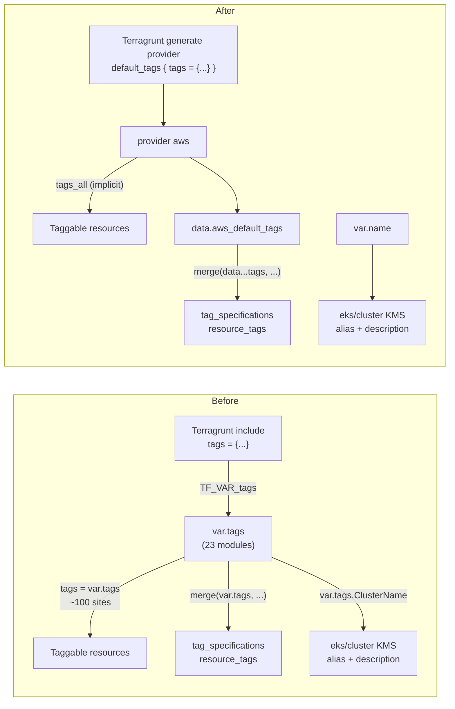
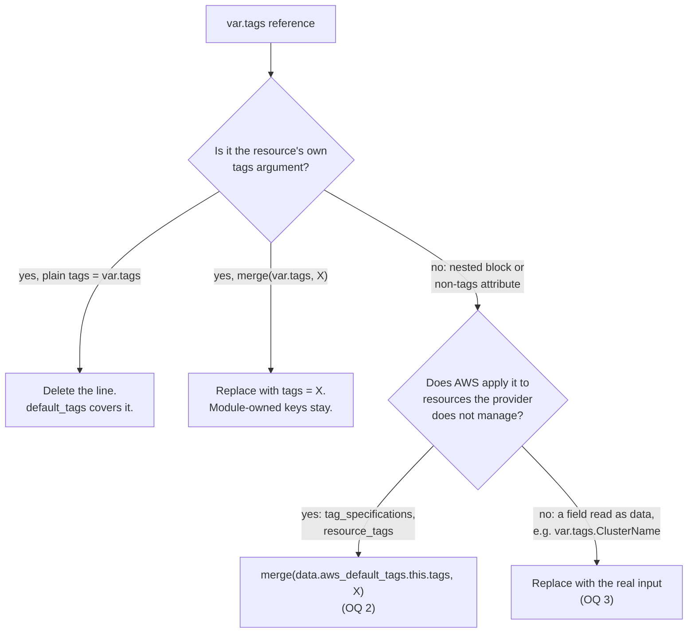
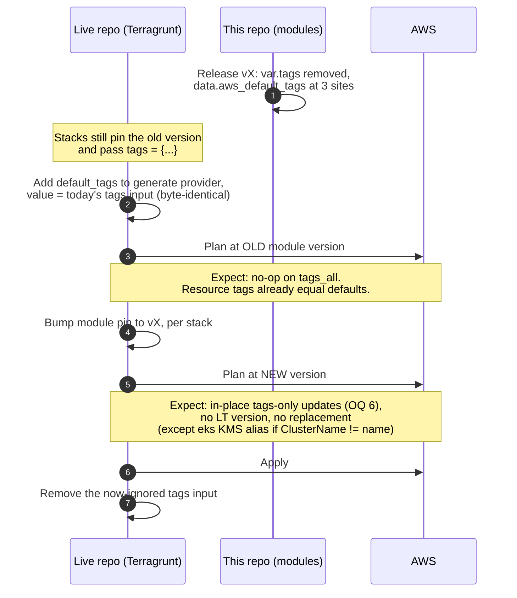

<!-- markdownlint-disable-file MD025 MD041 -->

# DESIGN-0029: Provider default_tags replace the per-module tags variable

**Status:** Approved
**Author:** Donald Gifford
**Date:** 2026-11-11

<!--toc:start-->
- [Overview](#overview)
- [Goals and Non-Goals](#goals-and-non-goals)
  - [Goals](#goals)
  - [Non-Goals](#non-goals)
- [Background](#background)
  - [Why now](#why-now)
  - [What default_tags does and does not reach](#what-default_tags-does-and-does-not-reach)
  - [Probe results (2026-11-11)](#probe-results-2026-11-11)
- [Detailed Design](#detailed-design)
  - [Tag flow, before and after](#tag-flow-before-and-after)
  - [Site classification rule](#site-classification-rule)
  - [Inventory](#inventory)
  - [The three special cases](#the-three-special-cases)
  - [Tag inputs that survive](#tag-inputs-that-survive)
  - [eks/cluster: the ClusterName coupling](#ekscluster-the-clustername-coupling)
  - [network/security-group: the Name guard](#networksecurity-group-the-name-guard)
  - [The one-time plan diff](#the-one-time-plan-diff)
- [API / Interface Changes](#api--interface-changes)
- [Data Model](#data-model)
- [Testing Strategy](#testing-strategy)
- [Migration / Rollout Plan](#migration--rollout-plan)
  - [Ordering](#ordering)
  - [Node-group roll avoidance](#node-group-roll-avoidance)
  - [Release notes content](#release-notes-content)
  - [Phases](#phases)
- [Open Questions](#open-questions)
  - [1. How much of the tags surface is removed?](#1-how-much-of-the-tags-surface-is-removed)
  - [2. How do sites that default_tags cannot reach get the default set?](#2-how-do-sites-that-default_tags-cannot-reach-get-the-default-set)
  - [3. What names the eks/cluster KMS key and alias once var.tags is gone?](#3-what-names-the-ekscluster-kms-key-and-alias-once-vartags-is-gone)
  - [4. Which resource-specific tag inputs survive?](#4-which-resource-specific-tag-inputs-survive)
  - [5. What happens to the security-group Name guard?](#5-what-happens-to-the-security-group-name-guard)
  - [6. Is the one-time tags-only plan diff an accepted exception to the zero-diff bar?](#6-is-the-one-time-tags-only-plan-diff-an-accepted-exception-to-the-zero-diff-bar)
  - [7. Do modules check that default tags are configured?](#7-do-modules-check-that-default-tags-are-configured)
  - [8. What is the release shape?](#8-what-is-the-release-shape)
  - [9. How is ADR-0001 updated?](#9-how-is-adr-0001-updated)
  - [10. How deep do the test suites assert default tags?](#10-how-deep-do-the-test-suites-assert-default-tags)
- [References](#references)
<!--toc:end-->

## Overview

Every module in the fleet except `network/vpc-lookup` declares a
`tags` input and threads it onto each taggable resource by hand. In
a fleet driven entirely by Terragrunt, that is redundant with the AWS
provider's `default_tags` block, which the live repo's generated
provider config can set once per stack. Worse, two modules
(`eks/cluster`, `eks/addons`) take `tags` as a **required typed
object** with five fixed keys, which forces a specific tag shape on
every EKS stack and blocks a uniform Terragrunt input set. This
design removes the generic `tags` variable from all 23 modules,
moves the fleet's standard tag set to provider `default_tags` in the
live repo, and handles the three places where `default_tags` cannot
reach.

## Goals and Non-Goals

### Goals

- One source of truth for the standard tag set: the live repo's
  generated `provider "aws"` block (`default_tags`). No module
  declares a generic `tags` input after this lands.
- Remove the `eks/cluster` / `eks/addons` typed-object `tags`
  requirement — the immediate blocker.
- No silent tag loss: every resource tagged today stays tagged with
  the same effective set (`tags_all`), including the resources
  `default_tags` does not reach (launch template
  `tag_specifications`, ECR creation-template `resource_tags`).
- No node rolls, no resource replacements caused by the migration
  itself, given the documented upgrade ordering.
- Test coverage proves the default set reaches resources, at the tier
  where that is provable (see [Testing Strategy](#testing-strategy)).

### Non-Goals

- Deciding the fleet's tag **taxonomy** (which keys, which values).
  That is a live-repo concern; this design only moves where the set
  is applied.
- Writing the live repo's Terragrunt `generate "provider"` change.
  This design specifies what it must contain and when it must land;
  the change itself lives in the live repo.
- Enforcing required tag keys. Tag policy (required keys, allowed
  values) belongs to AWS Organizations tag policies or to the live
  repo's plan-JSON conftest family (see the `policy/` note in
  CLAUDE.md: plan-JSON policies live in the live repo).
- Tagging resources AWS creates on our behalf outside the provider's
  reach (EKS-created ENIs and cluster security group, RDS-created
  snapshots beyond `copy_tags_to_snapshot`). Unchanged by this design.
- `network/vpc-lookup`'s `vpc_tags` / `*_subnet_tags` inputs. Those
  are **discovery filters**, not tags applied to resources, and are
  untouched.

## Background

ADR-0001 (Accepted) set the rule that derivations live in
Boilerplate-generated Terragrunt rather than in module locals, and
used `var.tags = { Account, ClusterName, ... }` as its worked example
of a "fully-formed input object". DESIGN-0002 / IMPL-0001 applied
that to `eks/cluster` by deleting the module's `local.tags`
aggregation and introducing the typed object. Every later module
copied the shape of the input, but loosened it to an optional
`map(string)` defaulting to `{}`.

### Why now

The typed object on `eks/cluster` and `eks/addons` has no default and
requires exactly `Account`, `ClusterName`, `ClusterType`,
`Environment`, `Region`. Terragrunt injects a uniform input set into
every stack (IMPL-0015 Q6a), so the EKS stacks need a special-cased
`tags` shape that no other stack uses. That makes it the one input
that cannot ride the shared include unchanged. Meanwhile the other 21
modules hand-thread a `map(string)` that, in practice, every stack
sets to the same per-account/per-environment set: exactly what
`default_tags` exists for.

ADR-0001's principle survives this design unchanged: the tag set is
still derived in Terragrunt and never in a module. Only the delivery
channel changes, from a module input to the generated provider block.

### What default_tags does and does not reach

`default_tags` merges into every resource that has a `tags` /
`tags_all` attribute pair. It does **not** reach:

| Site | Why `default_tags` misses it | Fleet occurrences |
|---|---|---|
| `aws_launch_template` `tag_specifications[*].tags` | Nested block attribute, not the resource's own `tags`. These tags are applied by EC2 to the **instances and volumes** the node group launches. | `eks/managed-node-group` (2: `instance`, `volume`) |
| `aws_ecr_repository_creation_template.resource_tags` | Resource has no `tags` attribute at all (schema-probed); `resource_tags` is applied by ECR to **repositories created later** by push / pull-through. | `ecr/org-registry` (2), `ecr/pull-through-cache` (1) |
| Resources with no tags support | e.g. `aws_kms_alias`, `aws_s3_bucket_policy`, `aws_ce_cost_allocation_tag`, `aws_ecr_pull_through_cache_rule` | Unaffected: they are not tagged today either. |

### Probe results (2026-11-11)

Run in a scratch root outside the repo against Terraform 1.15.8 and
`hashicorp/aws` 6.72.0 (resolved by the fleet's `~> 6.2`
constraint):

| # | Probe | Result |
|---|---|---|
| P1 | Real provider, fake creds, `default_tags` set: is `tags_all` known at plan? | **Yes.** `tags_all` shows the merged set at plan, so the real-provider-fake-creds plan suites can assert it. |
| P2 | `data "aws_default_tags"` with fake creds | **Reads offline** (`Read complete after 0s [id=aws]`), no API call. |
| P3 | `merge(data.aws_default_tags.this.tags, { Name = ... })` in `tag_specifications` | **Works**: the plan shows the default keys inside the launch template's `tag_specifications`. The launch template's own `tags_all` also gets them independently. |
| P4 | `data "aws_default_tags"` under `mock_provider` | Returns an **empty map** `{}` (deterministic, never unknown). `override_data` sets it. A `mock_provider` ignores provider config, so `default_tags` itself never reaches mocked resources. |
| P5 | `TF_VAR_tags` exported against a root with no `tags` variable | **Silently ignored**, with no warning. This is how Terragrunt passes inputs, so removing the variable does not break Terragrunt callers. |
| P6 | `.tftest.hcl` passing `tags` to a module that does not declare it | File-level `variables` block: **silent**. Run-level `variables` block: **warning**, run still passes. Stale test inputs will not fail a suite, so cleanup has to be grep-gated. |
| P7 | libtftest `SetVar("tags", …)` (`modules/eks/cluster/test`) | libtftest v0.2.0 passes vars to terratest as **`-var` flags**, and Terraform **errors** on an undeclared `-var`. The Go suite must drop its `SetVar("tags")` in the same change. |

## Detailed Design

### Tag flow, before and after



### Site classification rule

Every current `var.tags` reference is classified by one rule, applied
mechanically during implementation:



`merge(var.tags, X)` collapsing to `tags = X` is safe because resource
tags **override** `default_tags` on key collision, which is the same
precedence `merge(var.tags, X)` gives today (right-hand side wins).

### Inventory

Counts are non-test `var.tags` references, measured 2026-11-11 at
`1fbb4e6`. "Test files" counts `.tftest.hcl` files that mention
`tags`, each of which needs a look (most just pass the input).

| Module | `var.tags` refs | `merge(var.tags…)` | Test files | Notes |
|---|---:|---:|---:|---|
| `bedrock/claude-code` | 8 | 5 | 3 | `merge(var.tags, local.cost_tag_map)` becomes `tags = local.cost_tag_map`. `aws_budgets_budget` is deliberately untagged today but **will gain `default_tags`**. |
| `ecr/org-registry` | 7 | 2 | 1 | 2 × `resource_tags`: special case. |
| `ecr/pull-through-cache` | 3 | 0 | 1 | 1 × `resource_tags`: special case. |
| `efs/filesystem` | 7 | 1 | 2 | Access point `Name` merge stays as `tags = { Name = each.key }`. |
| `eks/access-entries` | 1 | 0 | 2 | |
| `eks/addons` | 9 | 0 | 5 | **Typed object** removed. |
| `eks/cluster` | 12 | 0 | 5 | **Typed object** removed; 2 × `var.tags.ClusterName` (OQ 3); Go suite `SetVar("tags")`. |
| `eks/managed-node-group` | 6 | 2 | 2 | 2 × `tag_specifications`: special case; **node-roll hazard**. |
| `eks/pod-identity-access` | 2 | 0 | 2 | `association_tags` survives (OQ 4). |
| `iam/role` | 1 | 0 | 2 | Plan + apply assert caller tags today. |
| `network/security-group` | 5 | 4 | 4 | `Name` merges stay; `Name` guard on `var.tags` (OQ 5); `expect_failures = [var.tags]` run. |
| `rds/cluster` | 9 | 0 | 1 | |
| `rds/instance` | 7 | 0 | 1 | |
| `rds/proxy` | 6 | 0 | 0 | |
| `rds/read-replica` | 1 | 0 | 0 | |
| `rds/serverless` | 9 | 0 | 1 | |
| `s3/internal/core` | 1 | 0 | 0 | Core input removed; triggers the s3 internal fan-out. |
| `s3/access-logs-bucket` | 1 | 0 | 0 | Passes `tags = var.tags` to core. |
| `s3/bucket` | 1 | 0 | 0 | Same. |
| `s3/events-bucket` | 1 | 0 | 0 | Same. |
| `s3/evidence-bucket` | 1 | 0 | 0 | Same. |
| `s3/mirror-bucket` | 1 | 0 | 0 | Same. |
| `secretsmanager/secret` | 1 | 0 | 1 | Plan asserts pass-through. |
| **Total** | **~100** | **14** | **33** | Plus 22 apply-suite / fixture files, 5 fixtures that instantiate real modules, 14 READMEs, every `USAGE.md`. |

### The three special cases

| Site | Today | After (OQ 2a) |
|---|---|---|
| `managed-node-group` LT `instance` spec (`launch_template.tf:57`) | `merge(var.tags, { Name = var.nodegroup_name })` | `merge(data.aws_default_tags.this.tags, { Name = var.nodegroup_name })` |
| `managed-node-group` LT `volume` spec (`launch_template.tf:62`) | `merge(var.tags, { Name = "${var.nodegroup_name}-root" })` | `merge(data.aws_default_tags.this.tags, { Name = "${var.nodegroup_name}-root" })` |
| `ecr/org-registry` templates (`templates.tf:76,133`) | `merge(var.tags, { artifact_type, managed_by })` | `merge(data.aws_default_tags.this.tags, { artifact_type, managed_by })` |
| `ecr/pull-through-cache` template (`template.tf:51`) | `var.tags` | `data.aws_default_tags.this.tags` |

One `data "aws_default_tags" "this"` per module that needs it (three
modules).

`data "aws_default_tags"` reads the **same provider configuration**
that applies `default_tags`, so the two paths cannot drift. This is
the same "one rule, two paths, no drift" shape `managed-node-group`
already uses for `kubelet_node_labels` versus the EKS API labels
(IMPL-0020 Phase 2).

### Tag inputs that survive

Only the generic `tags` variable goes. Inputs whose tags carry
module-specific meaning stay (OQ 4):

| Input | Module | Why it stays |
|---|---|---|
| `cost_tag` | `bedrock/claude-code` | Load-bearing: drives the budget **filter** and cost-allocation activation, not just labelling. Already documented as "NOT merged from `var.tags`". |
| `association_tags` | `eks/pod-identity-access` | Per-resource labels distinct from the role's (ownership migration use case, per its description). Now merges on top of `default_tags`. |
| Module-set `Name` keys | `security-group`, `efs/filesystem`, `managed-node-group` | Computed from module inputs; resource tags win over `default_tags`. |
| `vpc_tags`, `*_subnet_tags` | `network/vpc-lookup` | Discovery filters, not applied tags (Non-Goal). |

### eks/cluster: the ClusterName coupling

`eks/cluster` reads one field of the tag object as **data**, not as a
tag:

```hcl
# modules/eks/cluster/kms.tf
description = "EKS envelope encryption CMK for cluster ${var.tags.ClusterName}"  # :30
name        = "alias/eks/${var.tags.ClusterName}"                                # :40
```

Everything else in the module names itself from `var.name`
(`${var.name}-cluster`, `/aws/eks/${var.name}/cluster`, the cluster
`name`). The plan suites set `ClusterName == name`, so the two are
assumed to agree. The fleet's other KMS aliases are all derived from
the module's own name input (`alias/${var.identifier_prefix}-…`,
`alias/${var.name_prefix}-ecr-oci`).

Impact of switching to `var.name`, when a live cluster had
`ClusterName != name`:

- `aws_kms_key.description`: **in-place update**, no key change.
- `aws_kms_alias.name`: **replacement** of the alias only. The key
  and its material are untouched. Nothing in the fleet references the
  alias by name (`grep 'alias/eks'` finds only `kms.tf`); the cluster
  encryption config uses the **key ARN** (`local.kms_key_arn`). The
  risk is limited to a moment between alias destroy and create.
- When `kms_key_arn` is supplied (external key), neither resource
  exists, so there is no impact.

### network/security-group: the Name guard

The guard `!contains(keys(var.tags), "Name")` exists so callers
cannot fight the module-set `Name`. With `var.tags` gone, the guard
has nothing to inspect. A `Name` in `default_tags` is overridden by
the resource-level `Name` (resource tags win), so the original
failure (two sources disagreeing on `Name`) can no longer silently
win. It can only be shadowed, harmlessly. See OQ 5.

### The one-time plan diff

Even when the live `default_tags` set is exactly the old `var.tags`
value, the first plan after the module bump is **not** zero-diff on
config: each taggable resource's `tags` argument moves from the full
map to `null` (or to the module-owned keys only), while `tags_all`
(what AWS actually holds) is unchanged. This is expected to render as
an in-place `~ tags` update on every tagged resource, with no
replacement and no effective change in AWS. It conflicts with the
platform's zero-diff replan bar for the load-bearing eks modules
(ADR-0011, platform side) and needs an explicit decision (OQ 6). It
is **not yet probed** against state. Phase 4 proves the exact shape
(apply at the old version, bump, plan) before the release notes are
written.

The **exception within the exception** is
`eks/managed-node-group`: there the merged `tag_specifications` value
must be **byte-identical** before and after, because the node group
pins `launch_template.version = latest_version`. Any content change
mints a new launch template version and rolls every node. See
[Node-group roll avoidance](#node-group-roll-avoidance).

## API / Interface Changes

All changes are input removals and are breaking for any caller that
passes the input **by name in HCL or by `-var`**. They are
non-breaking for Terragrunt callers (P5).

| Module(s) | Removed | Added | Changed behavior |
|---|---|---|---|
| All 23 listed in [Inventory](#inventory) | `variable "tags"` | — | Resources carry `default_tags` via `tags_all` instead. |
| `eks/cluster` | `tags` (typed object, required) | — | KMS alias / description named from `var.name` (OQ 3a). |
| `eks/addons` | `tags` (typed object, required) | — | — |
| `eks/managed-node-group`, `ecr/org-registry`, `ecr/pull-through-cache` | — | `data "aws_default_tags" "this"` (internal) | `tag_specifications` / `resource_tags` sourced from provider default tags (OQ 2a). |
| `network/security-group` | `Name` validation on `tags` | — | OQ 5a. |
| `bedrock/claude-code` | — | — | `aws_budgets_budget` gains `default_tags` (was untagged). |

No outputs change. The eks remote-state shape (ADR-0020) and the
`eks/cluster` Go suite's exact output count are unaffected.

**Live-repo contract (new, documented in each README):** every stack
using these modules must set `default_tags` in its generated provider
block. The module no longer has any other way to tag resources.

## Data Model

No state-shape changes beyond the attribute moves described in
[The one-time plan diff](#the-one-time-plan-diff): `tags` shrinks,
`tags_all` is unchanged. No `moved` blocks are needed, since no resource
address changes. The only replacement anywhere is the conditional
`eks/cluster` KMS alias (OQ 3).

## Testing Strategy

Per OQ 10a:

- **Plan suites (the gate).**
  - Real-provider-fake-creds suites add `default_tags` to their
    test-file `provider "aws"` block and assert `tags_all` on one
    representative resource per module (P1). Where a module sets its
    own keys (`Name`, `cost_tag`), assert both the default key and
    the module key, and assert the module key **wins** on collision.
  - The three special-case modules assert the default key reaches
    `tag_specifications[*].tags` / `resource_tags`. This needs the
    real-provider pattern, or `override_data` on
    `data.aws_default_tags.this` under `mock_provider` (P4).
  - Existing "caller tags reach X" runs (`iam/role`,
    `secretsmanager/secret`, `security-group`,
    `bedrock/claude-code`) are rewritten from `var.tags` inputs to
    `default_tags` assertions, not deleted. Pass-through coverage is
    preserved, re-sourced.
  - `security-group`'s `expect_failures = [var.tags]` run is deleted
    with the guard (OQ 5a).
- **Removal gate.** Because stale `tags` in test files does not fail
  (P6), the IMPL adds a grep check: zero `var.tags`, zero
  `variable "tags"` under `modules/`, and zero `tags =` entries in
  `.tftest.hcl` `variables` blocks. This could be a one-off IMPL step
  or a permanent `scripts/static-check.sh` assertion.
- **Apply suites.** Each `tests-localstack*/` provider block gains
  `default_tags`. One read-back per family proves the tag reached AWS
  (LocalStack round-trips tags faithfully; this is a shape and wiring
  check, per the IMPL-0023 emulator rule).
- **Upgrade-diff probe (Phase 4).** For `eks/managed-node-group` and
  one plain module: apply at `v0.26.0` with `tags = X`, switch to the
  new module with `default_tags = X`, and plan. Record the exact diff
  in the module's FINDINGS. Success: node group shows **no** new
  launch template version, and the plain module shows `tags`-only
  in-place updates with `tags_all` unchanged.
- **Go suite.** Drop `SetVar("tags", …)` (P7), then
  `go vet -tags integration ./...` by hand. No CI gate compiles this
  suite.

## Migration / Rollout Plan

### Ordering



The non-negotiable step is **2 before 4**: if a stack bumps to `vX`
without `default_tags`, every resource drops its tags in place, and
nodes roll, because `tag_specifications` changes. Terragrunt will not
warn, since the leftover `tags` input is silently ignored (P5).

Step 3 matters too: adding `default_tags` while the old module still
passes identical resource-level `tags` should plan clean. AWS provider
v5+ tolerates duplicated identical keys. If it does not plan clean,
stop: the default set does not equal the old input.

### Node-group roll avoidance

For each `managed-node-group` stack, before bumping:

1. Read the current launch template's `tag_specifications` tags from
   state.
2. Make the stack's `default_tags` equal the old `tags` input
   **exactly** (keys and values; `Name` stays module-set).
3. After bumping, confirm the plan shows **no** change to
   `aws_launch_template.node` versions and **no** update to
   `aws_eks_node_group.this`. If it does, the default set differs;
   fix the live config, never apply.

### Release notes content

The `### RELEASE NOTES` block must carry:

- the removal list and the live-repo `default_tags` prerequisite,
  with the ordering above;
- the node-group byte-identical requirement;
- the `eks/cluster` alias replacement condition
  (`ClusterName != name`);
- the one-time tags-only diff (per OQ 6's resolution);
- the `bedrock/claude-code` budget gaining tags.

### Phases

1. **Core removal (mechanical).** Apply the classification rule
   across all 23 modules; remove `variable "tags"`; collapse
   `merge(var.tags, X)` to `X`; regenerate `USAGE.md`.
2. **Special cases.** Add `data.aws_default_tags` to the three
   modules; apply the `eks/cluster` naming decision (OQ 3); handle the
   `security-group` guard (OQ 5).
3. **Tests.** Rework plan suites, apply-suite provider blocks,
   fixtures that instantiate real modules (5), and the Go suite; add
   the removal grep gate.
4. **Upgrade-diff probe.** The before/after apply-and-plan from
   [Testing Strategy](#testing-strategy); record results in FINDINGS.
5. **Docs and release.** READMEs (live-repo contract, upgrade
   section), ADR-0001 update (OQ 9), CLAUDE.md, release notes.

## Open Questions

> **All resolved 2026-11-11: 1a, 2a, 3a, 4a, 5a, 6a, 7a, 8a, 9a,
> 10a.** The Detailed Design above was already written to the
> recommended shapes, so there are no amendments and the IMPL cuts
> directly from this doc. 6a stays **conditional** on the Phase 4
> upgrade-diff probe: if it shows anything beyond tags-only in-place
> updates (a replacement, a new launch template version, or a
> `tags_all` change), reopen OQ 6 before release.

### 1. How much of the tags surface is removed?

- **a. (Recommended) Remove the generic `tags` variable from all 23
  modules in one design.** One source of truth, with no module where
  `tags` still works and quietly double-applies. The bulk is
  mechanical (~100 sites, most are a plain `tags = var.tags` line
  deletion).
- b. Remove it only from `eks/cluster` and `eks/addons` (the
  blockers), and leave the optional `map(string)` elsewhere.
  Smallest change, but it leaves two tagging channels fleet-wide, and
  the live repo must keep passing `tags` to 21 modules.
- c. Keep `tags` everywhere and relax the two eks typed objects to
  optional `map(string)`. Unblocks Terragrunt with near-zero churn,
  but `default_tags` and `var.tags` coexist indefinitely.
- Other: ___

### 2. How do sites that default_tags cannot reach get the default set?

Launch template `tag_specifications` (node instances and volumes) and
ECR creation-template `resource_tags` (future repos).

- **a. (Recommended) `data "aws_default_tags"` merged at the site.**
  Probed offline-safe (P2) and mock-safe (P4). It reads the same
  provider config that applies `default_tags`, so the two cannot
  drift. No new input.
- b. Keep a narrow, purpose-named input at those three modules
  (e.g. `instance_tags`, `repository_tags`). Explicit, but the live
  repo must feed the same set twice, through two channels that can
  drift.
- c. Drop tags at those sites. Node EC2 instances, volumes, and
  future ECR repos go untagged, which breaks cost allocation for the
  largest-spend resources in the fleet.
- Other: ___

### 3. What names the eks/cluster KMS key and alias once var.tags is gone?

Today it is `var.tags.ClusterName` (`kms.tf:30,40`); everything else
in the module uses `var.name`.

- **a. (Recommended) `var.name`.** Consistent with the rest of the
  module and with every other module's alias. Where a live cluster
  has `ClusterName != name`, the alias is replaced (key untouched,
  nothing references the alias) and the description updates in place.
  The release notes call out the condition.
- b. Add an optional `kms_alias_name` override defaulting to
  `var.name`. Lets an operator pin the old alias for zero diff, at the
  cost of a new input that exists only for migration.
- c. Read `data.aws_default_tags.this.tags["ClusterName"]` with a
  `var.name` fallback. Preserves today's value exactly, but couples
  resource naming to the tag set, which is the coupling this design
  removes.
- Other: ___

### 4. Which resource-specific tag inputs survive?

- **a. (Recommended) Keep `bedrock/claude-code` `cost_tag` and
  `eks/pod-identity-access` `association_tags`; remove only the
  generic `tags`.** Both carry meaning beyond the default set
  (`cost_tag` is a budget filter; `association_tags` is per-resource
  ownership labelling), and both merge cleanly on top of
  `default_tags`.
- b. Keep `cost_tag`, remove `association_tags`. It would be the only
  per-resource tag input left in the fleet, and folding it into
  `default_tags` loses the ownership-migration use case.
- c. Remove both and move `cost_tag` into `default_tags`. Breaks the
  budget filter's single source and the module's documented
  "NOT merged from var.tags" contract.
- Other: ___

### 5. What happens to the security-group Name guard?

- **a. (Recommended) Delete the guard and its `expect_failures` run.**
  With no `var.tags`, there is nothing to validate. A `Name` in
  `default_tags` is overridden by the resource `Name`, so the guard's
  failure mode (caller and module disagreeing on `Name`) cannot win.
  README notes that `Name` is module-owned.
- b. Re-home it as a precondition on
  `data.aws_default_tags.this.tags` rejecting `Name`. Keeps the
  rejection, but fails a stack because of a provider-level setting it
  cannot override, and adds the data source to a fourth module.
- c. Turn it into a `check` block (a warning, not an error) over the
  same data source. Visible, non-blocking, but it is the fleet's first
  `check` block, and the warning has no actionable fix at the module
  level.
- Other: ___

### 6. Is the one-time tags-only plan diff an accepted exception to the zero-diff bar?

The first plan after the bump shows in-place `tags` changes with
`tags_all` unchanged (to be confirmed by the Phase 4 probe). The eks
modules are under the platform's zero-diff replan policy.

- **a. (Recommended) Accept it as a documented, one-time exception**,
  conditional on the Phase 4 probe proving `tags_all` is unchanged
  and no replacement or node roll occurs. Record it in the release
  notes and in this doc's resolution.
- b. Ship a transitional release that keeps `var.tags` declared but
  **unused** (deprecated), so the live repo can move to `default_tags`
  first. This still produces the same one-time `tags` diff when the
  argument leaves the resources, so it only reorders the diff rather
  than removing it, and it costs an extra release.
- c. Exempt the eks modules: keep `var.tags` there (as optional
  `map(string)`) and remove it everywhere else. Avoids the diff on the
  load-bearing modules, but keeps two channels (see 1b).
- Other: ___

### 7. Do modules check that default tags are configured?

The failure mode is a stack bumped before its live config sets
`default_tags`: silent tag loss, and node rolls.

- **a. (Recommended) No module-side check.** Document the ordering.
  Required-tag enforcement belongs to the live repo (plan-JSON
  conftest, per the `policy/` note) or to AWS Organizations tag
  policies. Modules stay thin, and test fixtures do not need a tag
  set to plan.
- b. A precondition requiring non-empty `data.aws_default_tags` in
  every module. Fails closed on the exact hazard, but turns tagging
  into a hard dependency of every plan, including every plan suite and
  sandbox run, and adds a data source to all 23 modules.
- c. A `check` block warning on empty default tags. Visible in
  Atlantis plan output without blocking. Same 23-module data-source
  cost; first `check` block in the fleet.
- Other: ___

### 8. What is the release shape?

- **a. (Recommended) One PR, one minor release** (pre-1.0, so a
  breaking change is a minor bump via the `minor` label). One
  `### RELEASE NOTES` upgrade section and one live-repo migration
  window. The change is atomic across the fleet, matching the
  single-source goal.
- b. One PR per service family, released over several minors.
  Smaller reviews, but the fleet sits in a mixed two-channel state
  for weeks, and the release notes repeat the ordering instructions
  per family.
- c. Two releases: first add `data.aws_default_tags` sites and
  deprecate `var.tags` (still honored), then remove. Gentlest, but
  "still honored" means merge precedence must be defined for both
  channels at the three special sites, which adds code that exists
  only to be deleted.
- Other: ___

### 9. How is ADR-0001 updated?

Its principle (derive in Terragrunt, not in modules) holds; its
`var.tags = { Account, ClusterName, ... }` example does not.

- **a. (Recommended) Amend ADR-0001 in place** with a dated note
  pointing to DESIGN-0029: the tag set is still derived in Terragrunt,
  now delivered through the generated provider block. The decision
  did not change; the example did.
- b. A new ADR that supersedes ADR-0001's tags paragraph only.
  More formal, but a partial supersession is awkward in docz's status
  model (ADR-0001 stays Accepted).
- c. No ADR change. This design is the record. Leaves an Accepted
  ADR whose worked example contradicts the codebase.
- Other: ___

### 10. How deep do the test suites assert default tags?

- **a. (Recommended) Plan suites assert `tags_all` on one
  representative resource per module, plus all three special-case
  sites; apply suites set `default_tags` and read back one resource
  per family; add a grep gate for leftovers.** Plan coverage is the
  gate (P1 makes it possible); the grep closes the silent-stale-input
  gap (P6).
- b. Plan suites only, with no apply-tier changes beyond deleting
  `tags` inputs. Cheaper, but nothing proves a tag reaches LocalStack
  through `tags_all`.
- c. Assert only the three special-case sites, and trust the
  provider for plain `tags_all`. Least churn, but it deletes the
  existing pass-through runs (`iam/role`, `secretsmanager/secret`,
  `security-group`, `bedrock`) without replacement.
- Other: ___

## References

- ADR-0001: remote-state composition, and derivation in Terragrunt (the
  `var.tags` worked example this design amends).
- ADR-0020: remote-state key contract (unaffected, since no output
  changes).
- DESIGN-0002 / IMPL-0001: introduced the `eks/cluster` typed tag
  object.
- IMPL-0015 Q6a: Terragrunt injects a uniform input set into every
  stack.
- IMPL-0020 Phase 2: the `kubelet_node_labels` one-rule-two-paths
  precedent for the `tag_specifications` data-source approach.
- IMPL-0023: emulator rule (LocalStack proves shape and wiring, not
  server-side contracts).
- AWS provider docs: `default_tags` provider argument and the
  `aws_default_tags` data source.
- Probe scratch root: `/tmp/dtprobe` (2026-11-11, not committed).
