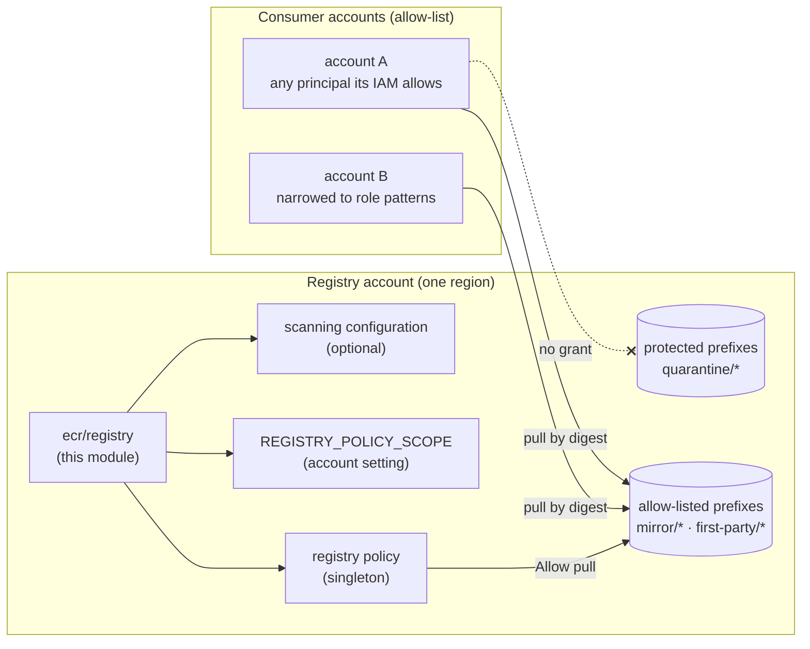

<!-- markdownlint-disable-file MD025 MD041 -->

# DESIGN-0030: ECR registry module with a cross-account pull allow-list

**Status:** Draft
**Author:** Donald Gifford
**Date:** 2026-11-12

<!--toc:start-->
- [Overview](#overview)
- [Goals and Non-Goals](#goals-and-non-goals)
  - [Goals](#goals)
  - [Non-Goals](#non-goals)
- [Background](#background)
- [Detailed Design](#detailed-design)
  - [Change map](#change-map)
  - [Resources](#resources)
  - [The consumer allow-list](#the-consumer-allow-list)
  - [Prefix scoping and protected prefixes](#prefix-scoping-and-protected-prefixes)
  - [Policy composition](#policy-composition)
  - [Additional policy statements](#additional-policy-statements)
  - [Registry policy scope](#registry-policy-scope)
  - [Scanning configuration](#scanning-configuration)
  - [Destroy and adoption semantics](#destroy-and-adoption-semantics)
  - [The consumer contract](#the-consumer-contract)
  - [Outputs](#outputs)
  - [Remote-state posture](#remote-state-posture)
  - [CI mechanics](#ci-mechanics)
- [API / Interface Changes](#api--interface-changes)
- [Data Model](#data-model)
- [Testing Strategy](#testing-strategy)
- [Phases](#phases)
  - [Phase 1: Module scaffold and policy composition](#phase-1-module-scaffold-and-policy-composition)
  - [Phase 2: Plan suite (the gate)](#phase-2-plan-suite-the-gate)
  - [Phase 3: Sandbox proof and docs](#phase-3-sandbox-proof-and-docs)
- [Open Questions](#open-questions)
  - [1. What is the module called?](#1-what-is-the-module-called)
  - [2. What shape is the allow-list?](#2-what-shape-is-the-allow-list)
  - [3. What does an empty allow-list do?](#3-what-does-an-empty-allow-list-do)
  - [4. Which actions does the consumer grant carry?](#4-which-actions-does-the-consumer-grant-carry)
  - [5. How are protected prefixes enforced?](#5-how-are-protected-prefixes-enforced)
  - [6. Does the module manage REGISTRY_POLICY_SCOPE?](#6-does-the-module-manage-registry_policy_scope)
  - [7. What is the scanning default?](#7-what-is-the-scanning-default)
  - [8. What shape are additional policy statements?](#8-what-shape-are-additional-policy-statements)
  - [9. Where do account ID and region come from?](#9-where-do-account-id-and-region-come-from)
  - [10. Is a remote-state key reserved?](#10-is-a-remote-state-key-reserved)
  - [11. What harness runs the sandbox proof?](#11-what-harness-runs-the-sandbox-proof)
- [References](#references)
<!--toc:end-->

## Overview

A new module, `modules/ecr/registry`, that is the **single owner of an
ECR private registry's registry-level configuration** in one account
and region. Its headline feature is an **account allow-list**: named
AWS accounts may pull from named repository prefixes, with no org-wide
or OU-wide grant. It also owns the registry's policy scope setting and,
optionally, its scanning configuration.

It is the first deliverable of INV-0012 (OQ 12a, DESIGN 1). The
quarantine/mirror repository templates, signing keys and sync examples
are DESIGN-0031.

## Goals and Non-Goals

### Goals

- One module owns `aws_ecr_registry_policy` for its account and region,
  so no two stacks ever overwrite each other's registry policy
  (INV-0012 F3).
- Cross-account **pull** for an explicit list of 12-digit account IDs,
  granted as `arn:aws:iam::<id>:root` principals (INV-0012 F5), with an
  optional per-account `aws:PrincipalArn` narrowing.
- The grant is **scoped to an allow-list of repository prefixes**. It
  can never reach a protected prefix such as `quarantine/` (INV-0012
  F6).
- Works for consumer clusters **we did not build**. The module never
  reads consumer state, and publishes a contract (registry hostname,
  prefixes, identity-policy JSON) as outputs (INV-0012 F7).
- An additive pass-through for other registry-policy needs (for
  example, cross-account replication), with reserved-sid protection.
- Plan-time validation of every input whose mistake widens access or
  silently grants nothing.

### Non-Goals

- **No org or OU grant.** No `aws:PrincipalOrgID` or
  `aws:PrincipalOrgPaths` input. A caller who needs one can pass a
  statement through `additional_policy_statements`.
- **No repositories or creation templates.** Purpose modules own those
  (`ecr/org-registry` today, DESIGN-0031's intake module next).
- **No changes to `ecr/org-registry` or `ecr/pull-through-cache`**
  (INV-0012 scope decisions). Both coexist with this module unchanged.
- **No consumer-side module.** Pull-only consumers need nothing beyond
  the AWS-managed ECR read policy EKS node roles normally carry
  (INV-0012 OQ 5a).
- **No replication configuration in v1.** It is a registry singleton
  too, so it belongs here later, as an additive input.
- **No push, import or cache-population grants** to consumer accounts.
- **No Kubernetes objects** (admission policies live in GitOps).

## Background

INV-0012 concluded (all OQs resolved 2026-11-12):

- A cross-account grant has to live in the **registry policy**. A
  creation template's `repository_policy` reaches only repositories
  created after it, and never backfills (F4).
- The registry policy, scanning configuration, replication
  configuration and account settings are **per-registry singletons**.
  `PutRegistryPolicy` replaces the whole document, so two owners
  produce a silent last-writer-wins (F3). No module in the fleet
  manages any of them today (F1).
- A registry-wide grant (`repository/*`) would expose `quarantine/*`,
  so the grant is a prefix allow-list that fails closed (F6, OQ 3a).
- Account-ID principals carry none of IMPL-0022's dangling-principal
  risk, but a mistyped account ID grants to a stranger, so the list is
  validated and plan-pinned (F5).

Three probes from this design's research:

- **ECR is not served by token-free LocalStack 4.4.**
  `PutRegistryPolicy`, `PutAccountSetting`,
  `PutRegistryScanningConfiguration` and
  `CreateRepositoryCreationTemplate` all fail with "not included in
  your current license plan" (probed 2026-11-12). `org-registry`'s
  FINDINGS record creation templates returning 501 **even on Pro**.
  Per the standing rule against new Pro dependencies, this module has
  **no LocalStack apply tier**. The plan suite is the gate, and a
  real-AWS sandbox runbook proves evaluation.
- **Provider schema (`hashicorp/aws` 6.72.0):**
  - `aws_ecr_registry_policy` takes `policy` only.
  - `aws_ecr_account_setting` takes `name` + `value`.
  - `aws_ecr_registry_scanning_configuration` takes `scan_type`, plus
    a set of `rule { scan_frequency, repository_filter { filter,
    filter_type } }`.
  - None of the three is taggable.
- **Fleet precedent:** `ecr/org-registry` resolves its account through
  `data.aws_caller_identity` (no Terragrunt globals).
  `network/security-group` and `s3/mirror-bucket` set the
  `required_version >= 1.9` precedent for cross-variable validation.

## Detailed Design

### Change map

```text
modules/ecr/registry/            CREATE   the singleton module
modules/ecr/org-registry/        NONE     coexists (repository policies untouched)
modules/ecr/pull-through-cache/  NONE     out of scope (INV-0012 OQ 6a)
docs/adr/0020-*.md               EDIT     reserved flat key (OQ 10)
```



### Resources

| Resource | Gate | Notes |
| --- | --- | --- |
| `aws_ecr_registry_policy.this` | `count` = 1 when at least one statement renders (OQ 3) | Composed with `jsonencode` (below) |
| `aws_ecr_account_setting.registry_policy_scope` | `count` on `manage_registry_policy_scope` (OQ 6) | `name = "REGISTRY_POLICY_SCOPE"`, `value = "V2"` |
| `aws_ecr_registry_scanning_configuration.this` | `count` on `scanning != null` (OQ 7) | Takes ownership of the registry's scanning setup |
| `data.aws_caller_identity.current`, `data.aws_region.current` | always | Deterministic repository ARNs (OQ 9) |

`required_version = ">= 1.9"` for the cross-variable validations.
There is no `tags` variable (DESIGN-0029) and nothing taggable.

### The consumer allow-list

```hcl
variable "consumer_accounts" {
  description = "Accounts allowed to pull from pull_repository_prefixes, keyed by 12-digit account ID."
  type = map(object({
    principal_arn_patterns = optional(list(string), [])
  }))
  default  = {}
  nullable = false
}
```

Keyed by account ID, so adding or removing one account never reorders
another (OQ 2). Validations, one rule per block so each rejection run
can be verified against its own message (IMPL-0020 discipline):

1. Every key matches `^[0-9]{12}$`.
2. Every pattern starts with `arn:aws:iam::<that key>:`. A pattern
   naming a different account matches nothing, so the account would
   silently get **no** access.
3. Patterns contain no whitespace and are not the bare `arn:aws:iam::<id>:*`
   (which is equivalent to no narrowing and should be written as
   `[]`).
4. A precondition on the policy resource rejects the registry's **own**
   account ID. Same-account access is IAM's job, and a self-grant here
   reads as narrowing while doing nothing.

Duplicate accounts are impossible by construction (map keys).

### Prefix scoping and protected prefixes

```hcl
variable "pull_repository_prefixes" {
  type     = list(string)   # e.g. ["mirror", "apps"]
  default  = []
  nullable = false
}

variable "protected_prefixes" {
  type     = list(string)
  default  = ["quarantine"]
  nullable = false
}
```

Each prefix renders as `arn:aws:ecr:<region>:<self>:repository/<prefix>/*`.
Validations:

- Each prefix matches the ECR repository-name grammar
  (`^[a-z0-9]+(?:[._-][a-z0-9]+)*(?:/[a-z0-9]+(?:[._-][a-z0-9]+)*)*$`),
  so there is no `*`, no leading or trailing `/`, and nothing
  uppercase. This rules out `repository/*` by construction.
- No duplicates.
- **Cross-variable:** a non-empty `consumer_accounts` requires a
  non-empty `pull_repository_prefixes`, since accounts with nothing
  to read are a silent no-op.
- **Cross-variable:** no pull prefix equals, contains, or is contained
  by a protected prefix. `quarantine`, `quarantine/mirror` and a
  hypothetical parent of `quarantine` are all rejected.

The protected-prefix list is enforced **twice** (OQ 5b):

- the plan-time overlap validation above stops an operator from
  listing a protected prefix;
- an explicit `ConsumerDenyProtected` statement (below) denies every
  allow-listed account **all** ECR actions on the protected prefixes.
  An explicit Deny beats any Allow, so it holds even when an
  over-broad statement in `additional_policy_statements` grants a
  consumer `repository/*`.

### Policy composition

The document is built with `jsonencode` from locals, **not**
`aws_iam_policy_document`. Three reasons:

1. Principal lists stay lists, so the single-element collapse
   (`aws_iam_policy_document` renders one principal as a string) never
   happens and assertions have one shape (INV-0012 P5 becomes
   unnecessary).
2. The plan suite can run under `mock_provider`.
3. Every ARN is composed from known-at-plan values.

Statements:

- `ConsumerPull`: one statement for every account with **no**
  narrowing. Present only when at least one such account exists.
- `ConsumerPull<account_id>`: one statement per **narrowed** account,
  carrying `ArnLike` on `aws:PrincipalArn`. A per-account statement is
  needed because the condition differs per account, and conditions
  AND within a statement.
- `ConsumerDenyProtected`: `Effect: Deny`, the `:root` principal of
  **every** allow-listed account (plain and narrowed), `Action: ecr:*`,
  and resources `repository/<protected>/*` for each protected prefix.
  An account principal in a resource-policy Deny matches every
  principal in that account. The statement is present only when there
  is at least one account and at least one protected prefix. It does
  not affect same-account principals (intake, writers), because only
  consumer accounts are named.
- `additional_policy_statements`, appended unchanged (below).

Example rendering, with one plain account and one narrowed account:

```json
{
  "Version": "2012-10-17",
  "Statement": [
    {
      "Sid": "ConsumerPull",
      "Effect": "Allow",
      "Principal": { "AWS": ["arn:aws:iam::111111111111:root"] },
      "Action": [
        "ecr:BatchCheckLayerAvailability",
        "ecr:BatchGetImage",
        "ecr:GetDownloadUrlForLayer"
      ],
      "Resource": [
        "arn:aws:ecr:us-east-1:999999999999:repository/apps/*",
        "arn:aws:ecr:us-east-1:999999999999:repository/mirror/*"
      ]
    },
    {
      "Sid": "ConsumerPull222222222222",
      "Effect": "Allow",
      "Principal": { "AWS": ["arn:aws:iam::222222222222:root"] },
      "Action": ["…same three…"],
      "Resource": ["…same prefixes…"],
      "Condition": {
        "ArnLike": {
          "aws:PrincipalArn": ["arn:aws:iam::222222222222:role/*-node-*"]
        }
      }
    },
    {
      "Sid": "ConsumerDenyProtected",
      "Effect": "Deny",
      "Principal": {
        "AWS": [
          "arn:aws:iam::111111111111:root",
          "arn:aws:iam::222222222222:root"
        ]
      },
      "Action": ["ecr:*"],
      "Resource": [
        "arn:aws:ecr:us-east-1:999999999999:repository/quarantine/*"
      ]
    }
  ]
}
```

Lists are sorted before encoding (`sort(keys(...))`, `sort(prefixes)`),
so input reordering never produces a diff. `ecr:GetAuthorizationToken`
is identity-only (it has no resource) and does not appear. It is in
the consumer contract instead.

### Additional policy statements

Because this module is the registry policy's only owner, any other
registry-level grant has to come through it. One example is a
cross-account replication source. The input mirrors the s3 family's
additive pass-through:

```hcl
variable "additional_policy_statements" {
  type = list(object({
    sid        = string
    effect     = string
    principals = list(object({ type = string, identifiers = list(string) }))
    actions    = list(string)
    resources  = list(string)
    conditions = optional(list(object({
      test     = string
      variable = string
      values   = list(string)
    })), [])
  }))
  default  = []
  nullable = false
}
```

Validations:

- Each `sid` is alphanumeric.
- `sid`s are unique.
- No `sid` starts with the reserved `Consumer` prefix (covering
  `ConsumerPull*` and `ConsumerDenyProtected`), so an operator
  statement can never shadow or impersonate the module's statements.
- `effect` is `Allow` or `Deny`.
- Actions start with `ecr:`.

Like the s3 family, the module renders these as given. It does **not**
inspect them for widening; that is code review's job, and the README
says so (OQ 8).

### Registry policy scope

ECR's `REGISTRY_POLICY_SCOPE` account setting has two values:

- `V1` (legacy): the registry policy covers only replication and
  pull-through-cache actions.
- `V2`: "Amazon ECR allows all ECR actions in the policy and enforces
  the registry policy in all ECR requests."

> **Build note (IMPL-0027 Phase 1, 2026-11-12):** LocalStack Pro
> 2026.10.7 models only the V1 scope and **rejects** a registry policy
> containing pull actions at `PutRegistryPolicy`. A real V1 registry
> is expected to do the same, so the account setting must be applied
> **before** the policy: the registry policy carries an explicit
> `depends_on` on `aws_ecr_account_setting.registry_policy_scope`.
> `manage_registry_policy_scope = false` is only safe on a registry
> already on V2, and the README says so. Sandbox P1 records the real
> V1 behaviour.

Pull grants need V2. With `manage_registry_policy_scope = true` (the
recommended default, OQ 6), the module pins `V2` with
`aws_ecr_account_setting`. INV-0012 P1 confirms in the sandbox that
the pull grant works on V2 and fails on V1. That turns the default
from "documented" into "proven".

### Scanning configuration

```hcl
variable "scanning" {
  type = object({
    scan_type = string            # BASIC | ENHANCED
    rules = list(object({
      scan_frequency = string     # SCAN_ON_PUSH | CONTINUOUS_SCAN | MANUAL
      filters        = list(string)  # WILDCARD filters, e.g. ["quarantine/*"]
    }))
  })
  default = null
}
```

**Scanning is off by default** (OQ 7a): `null` means the module creates
no scanning resource and leaves the registry's existing scanning setup
alone. It does not actively disable scanning the account already has. A non-null value **takes ownership**: the
resource replaces the registry's whole scanning configuration.
Coherence validations:

- `BASIC` allows `SCAN_ON_PUSH` and `MANUAL` only.
- `ENHANCED` allows `SCAN_ON_PUSH` and `CONTINUOUS_SCAN`.
- Every rule has at least one filter.

Without these, a `BASIC` + `CONTINUOUS_SCAN` pair would plan clean and
fail at apply. That is the emulator lesson from IMPL-0023: only
plan-time validation guards server-side contracts. ENHANCED scanning
enables Amazon Inspector billing for the account; the README states
that plainly.

### Destroy and adoption semantics

The README documents these, and `terraform test` cannot show them:

- **Destroying the stack deletes the registry policy.** Every
  allow-listed account loses access at once. There is no
  `prevent_destroy`, because `lifecycle` is static and the policy is
  cheap to recreate, but the README's "Removing this module" section
  says so plainly.
- Destroying the scanning resource reverts the registry to its default
  scanning behaviour, and destroying the account setting may leave
  `V2` in place. The IMPL **verifies both in the sandbox** rather than
  asserting them here.
- **Adoption:** a registry that already has a hand-written policy is
  adopted with an `import` block. Because the module manages the whole
  document, the existing statements must be carried into
  `consumer_accounts` or `additional_policy_statements` first, or the
  apply removes them. The resource has no `name_prefix`, so a faithful
  carry-over imports zero-diff, unlike the fleet's `name_prefix`
  modules (CLAUDE.md's import-equals-replacement finding).

### The consumer contract

The README's "Consumer contract" section is the interface for clusters
we did not build:

1. **Prerequisite in the consumer account:** the node role (or any
   pulling principal) has `ecr:GetAuthorizationToken` on `*` and the
   pull actions on the registry's repository ARNs.
   `AmazonEC2ContainerRegistryReadOnly` / `…PullOnly` already cover
   this, and the `consumer_identity_policy_json` output is the minimal
   equivalent for hand-scoped roles.
2. **Image references** use the full registry hostname and a digest:
   `<registry_url>/mirror/<upstream>/<path>@sha256:<digest>`. The
   kubelet ECR credential provider on EKS AMIs matches any
   `*.dkr.ecr.*.amazonaws.com` host, so no node configuration is
   needed (INV-0012 P3).
3. **Readable prefixes** are exactly `pull_repository_prefixes`.
4. **Same region.** The module grants in one region; cross-region
   consumers are out of scope.

### Outputs

| Output | Value |
| --- | --- |
| `registry_id` | The account ID |
| `registry_url` | `<id>.dkr.ecr.<region>.amazonaws.com` |
| `consumer_account_ids` | Sorted allow-listed IDs |
| `pull_repository_prefixes` | Sorted prefixes |
| `pull_repository_arns` | The rendered resource ARNs |
| `registry_policy_json` | The composed document, or `null` when none renders (the plan suite's test window) |
| `consumer_identity_policy_json` | The minimal identity policy a consumer principal needs |
| `registry_policy_scope` | `"V2"`, or `null` when unmanaged |

### Remote-state posture

The module reads no remote state. It is a registry singleton, so the
recommended publication is a **flat reserved key**
`<account_name>/<region>/ecr/registry/terraform.tfstate`, in the
`s3/access-logs` style: one per account and region, no `<name>`
segment. It is recorded in ADR-0020 ahead of any consumer, as `iam`
and `sg` were (OQ 10).

### CI mechanics

- No `tests-localstack/` directory, so `scripts/changed-modules.sh`
  puts the leaf in the **plan** tier only. The IMPL confirms this with
  `just changed`.
- `just static` covers fmt, validate, tflint, docs and conftest
  automatically. There is no credential surface.
- The README records the LocalStack divergence (ECR not served on 4.4,
  creation templates 501 on Pro), so nobody adds an apply tier
  expecting it to work.

## API / Interface Changes

New module `modules/ecr/registry`:

```hcl
variable "consumer_accounts"             # map(object), default {}
variable "pull_repository_prefixes"      # list(string), default []
variable "protected_prefixes"            # list(string), default ["quarantine"]
variable "additional_policy_statements"  # list(object), default []
variable "manage_registry_policy_scope"  # bool, default true
variable "scanning"                      # object, default null
```

```hcl
output "registry_id"
output "registry_url"
output "consumer_account_ids"
output "pull_repository_prefixes"
output "pull_repository_arns"
output "registry_policy_json"
output "consumer_identity_policy_json"
output "registry_policy_scope"
```

No existing module's interface changes.

## Data Model

None. The registry policy is the only data the module manages, and its
shape is specified above.

## Testing Strategy

**Plan suite (`tests/`, `mock_provider`, the gate).** Every policy
assertion decodes `registry_policy_json` and checks
statement-by-statement, never by string match. Planned runs:

- **Bare call:** no accounts and no statements renders **no** policy
  resource. Pins every default (`manage_registry_policy_scope`, scope
  `V2`, `scanning = null` → no scanning resource).
- **One plain account:** exactly one `ConsumerPull` statement. The
  principal is a **list** of one `:root` ARN, there are exactly three
  actions, and the resources equal the prefix ARNs.
- **Two plain accounts** share one statement, with a two-element
  principal list.
- **One narrowed account:** `ConsumerPull<id>` carries `ArnLike`
  `aws:PrincipalArn` with exactly the given patterns, and
  `keys(Condition) == ["ArnLike"]`.
- **Mixed:** plain and narrowed accounts give two pull statements, and
  the narrowed account does **not** appear in `ConsumerPull`.
- **Protected deny:** `ConsumerDenyProtected` names **every** account
  (plain and narrowed), carries `ecr:*`, and has exactly the protected
  prefix ARNs. With `protected_prefixes = []`, or with no accounts, the
  statement is absent.
- **Deny survives an over-broad pass-through:** with an additional
  statement granting a consumer `repository/*`, the deny is still
  present and unchanged (the plan-tier half of the sandbox leg
  below).
- **Ordering:** reordered inputs render byte-identical JSON.
- **Additive merge:** an operator statement is present, unchanged, and
  after the module's statements.
- **Scanning on:** the resource exists with the given type, rules and
  filters.
- **Outputs:** `registry_url` equality,
  `consumer_identity_policy_json` decoded (GetAuthorizationToken on
  `*`, pull actions on the prefix ARNs).
- **Rejections**, each verified per rule by a message probe or a
  mutation, since many validations stack on `consumer_accounts` and
  the prefix lists:
  - malformed account ID;
  - a pattern naming another account;
  - an equivalent-to-none pattern;
  - self-account (precondition);
  - accounts without prefixes;
  - a prefix with `*`, uppercase, or a leading `/`;
  - a duplicate prefix;
  - a prefix overlapping a protected one, in both directions;
  - a reserved sid;
  - a duplicate sid;
  - a non-`ecr:` action;
  - BASIC + CONTINUOUS_SCAN;
  - an empty filter list.
- **Positive runs for every regex-shaped rule**, so a rule that
  rejects everything cannot pass green. This is the IMPL-0024 RE2
  lesson: a fail-only run proves nothing about what the rule lets
  through.

**Sandbox runbook (`tests-sandbox/`, real AWS, opt-in, two accounts,
OQ 11).** These are INV-0012's probes, run before the IMPL is closed:

| Leg | Expectation |
| --- | --- |
| P1 | With scope `V2`, an allow-listed account pulls from a repository that has **no** repository policy. With `V1`, the same pull is refused. |
| P2 | The allow-listed account is refused on `quarantine/*` and allowed on `mirror/*`. It is still refused on `quarantine/*` when an additional statement grants it `repository/*`, proving the explicit Deny. (The cross-module leg also runs in DESIGN-0031's runbook.) |
| P3 | A node we did **not** build (a plain EKS-optimized AMI node, or an EC2 instance with the AWS-managed read policy) pulls `<registry_url>/mirror/…@sha256:…` with no node configuration. |
| Narrowing | A non-matching role in the narrowed account is refused, and a matching role is allowed. |
| Destroy | After destroy, the consumer pull is refused, and the scanning and scope settings are recorded as observed. |

## Phases

### Phase 1: Module scaffold and policy composition

- [ ] Scaffold `modules/ecr/registry` (versions `>= 1.9`, no `tags`)
- [ ] Locals composing the statements with `jsonencode`, sorted inputs
- [ ] Registry policy, account setting and scanning resources with
      their gates
- [ ] All validations and the self-account precondition
- [ ] Outputs, including `consumer_identity_policy_json`

### Phase 2: Plan suite (the gate)

- [ ] Shape, ordering, additive, scanning and output runs
- [ ] Rejection runs, each verified per rule, plus positive runs for
      regex rules
- [ ] `just static` green; `just changed` shows the plan tier only

### Phase 3: Sandbox proof and docs

- [ ] `tests-sandbox/` runbook (OQ 11) covering the legs above, run
      live, with results recorded in `tests-sandbox/FINDINGS.md`
- [ ] README: consumer contract, destroy and adoption sections, the
      LocalStack divergence, and the ENHANCED-scanning cost note
- [ ] ADR-0020 reserved-key row (OQ 10); `docz update`

Success criteria: the plan suite is green with every rejection
verified per rule; the sandbox proves P1–P3 and narrowing; a consumer
cluster not built by this repo pulls by digest with no node changes.

## Open Questions

> **All resolved 2026-11-12: 1a, 2a, 3a, 4a, 5b, 6a, 7a, 8a, 9a, 10a,
> 11a.**
>
> - **OQ 5 (b):** protected prefixes get the plan-time overlap
>   validation **and** an explicit `ConsumerDenyProtected` statement
>   naming every allow-listed account. The Detailed Design, the
>   reserved-sid rule (now the `Consumer` prefix) and the test plan
>   are amended to match.
> - **OQ 7 (a):** scanning is off by default: `scanning = null`
>   creates no scanning resource.

Each question lists **a** as the recommendation, then alternatives.
"Other" is open for your own answer.

### 1. What is the module called?

- **a. (Recommended) `ecr/registry`.** It owns the registry's own
  settings, which is what the name says.
- b. `ecr/registry-policy`. Accurate today, but wrong once it owns
  scanning and replication.
- c. `ecr/registry-settings`.
- Other: ___

### 2. What shape is the allow-list?

- **a. (Recommended) `map(object({ principal_arn_patterns }))` keyed by
  account ID.** It is order-stable and duplicate-free by construction,
  and narrowing sits next to the account it narrows.
- b. `list(string)` of IDs, plus a separate
  `map(list(string))` of patterns. Two inputs that can disagree.
- c. `list(object({ account_id, principal_arn_patterns }))`. It needs a
  duplicate-ID validation, and reordering it is noisy.
- Other: ___

### 3. What does an empty allow-list do?

- **a. (Recommended) Allowed.** With no accounts and no additional
  statements, no registry policy resource renders, so the module can
  own scanning and scope alone. Removing the last account deletes the
  policy, which is the correct end state.
- b. Require at least one account.
- c. Render an empty-statement policy. Not viable: ECR rejects a policy
  with no statements.
- Other: ___

### 4. Which actions does the consumer grant carry?

- **a. (Recommended) Exactly the pull trio:**
  `BatchCheckLayerAvailability`, `BatchGetImage`,
  `GetDownloadUrlForLayer`. That is sufficient for kubelet, `crane` and
  `docker` pulls, including resolving a tag to a digest.
- b. The trio plus `DescribeImages` / `DescribeRepositories`, for
  parity with `org-registry`'s `org_pull`. Lets consumers list
  repositories and tags.
- c. A configurable action list.
- Other: ___

### 5. How are protected prefixes enforced?

- **a. (Recommended) A plan-time overlap validation only.** The
  allow-list already fails closed, so the guard just stops the one
  dangerous listing.
- b. The validation, **plus** an explicit `Deny` on protected prefixes
  for every consumer account. This survives an over-broad operator
  statement in `additional_policy_statements`, at the cost of a second
  statement per render.
- c. No guard; rely on review.
- Other: ___

### 6. Does the module manage REGISTRY_POLICY_SCOPE?

- **a. (Recommended) Yes, pinned to `V2` by default, with an opt-out
  bool.** Pull grants need V2, and pinning it removes the "works in
  one account, not another" failure. Sandbox P1 confirms the need.
- b. Never manage it; document that the account must be on V2.
- c. Manage it only if P1 shows V1 registries refuse the grant.
- Other: ___

### 7. What is the scanning default?

- **a. (Recommended) `null`: don't manage scanning unless asked.**
  Taking ownership silently replaces whatever the account has, and
  ENHANCED carries Inspector cost. The README shows the
  quarantine-focused example.
- b. Default to BASIC scan-on-push for `*`. Free, but it takes
  ownership on every invocation.
- c. Default to ENHANCED continuous scanning, per the internal
  standard.
- Other: ___

### 8. What shape are additional policy statements?

- **a. (Recommended) A typed object list** (the s3 family shape), with
  reserved-sid, uniqueness, effect and `ecr:`-action validation.
- b. A list of raw JSON statement strings. More flexible, but nothing
  is validated.
- c. No pass-through in v1. Simplest, but then nothing else can ever
  use the registry policy, since this module must be its only owner.
- Other: ___

### 9. Where do account ID and region come from?

- **a. (Recommended) `data.aws_caller_identity` and `data.aws_region`**,
  as `org-registry` does. They always match the provider that applies
  the policy, and the module declares none of the Terragrunt globals.
- b. The Terragrunt globals `account_id` + `region`, as
  `s3/mirror-bucket` does. That needs no data sources, but a mismatch
  with the provider renders ARNs for the wrong account.
- Other: ___

### 10. Is a remote-state key reserved?

- **a. (Recommended) Reserve the flat key
  `<account_name>/<region>/ecr/registry/` in ADR-0020** (the
  `access-logs` reserved-stack-name pattern), ahead of any consumer.
- b. Reserve nothing until a consumer exists.
- c. A `<name>`-keyed shape (`ecr/registry/<name>/`). Not useful, since
  there is one registry per account and region.
- Other: ___

### 11. What harness runs the sandbox proof?

- **a. (Recommended) A `tests-sandbox/` shell runbook** using two AWS
  CLI profiles (registry account, consumer account), following
  `s3/mirror-bucket`'s precedent. The quarantine/mirror cross-module
  legs live in DESIGN-0031's runbook.
- b. A libtftest Go suite with two provider configurations.
- c. A manual checklist in the README.
- Other: ___

## References

- INV-0012: ECR cross-account sharing without org scope, and an image
  sync pipeline (F1–F7, OQs 1–5, 11, 12).
- DESIGN-0031: ECR image intake and KMS signing key modules (the
  quarantine/mirror half).
- ADR-0020: remote-state key contract (reserved-stack-name pattern).
- DESIGN-0026 / IMPL-0023: `network/security-group` (`>= 1.9`
  cross-variable validation; the plan-time-only server-contract
  lesson).
- DESIGN-0025 / IMPL-0022: `iam/role` (account-ID validation, the
  dangling-principal lesson).
- DESIGN-0028 / IMPL-0025: `s3/mirror-bucket` (`tests-sandbox/`
  runbook precedent).
- DESIGN-0029 / IMPL-0026: provider `default_tags` (no `tags`
  variable).
- AWS: *Private registry permissions in Amazon ECR*;
  *PutAccountSetting* (`REGISTRY_POLICY_SCOPE`);
  *PutRegistryScanningConfiguration*.
