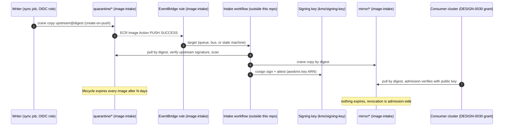

<!-- markdownlint-disable-file MD025 MD041 -->

# DESIGN-0031: ECR image intake and KMS signing key modules

**Status:** Draft
**Author:** Donald Gifford
**Date:** 2026-11-12

<!--toc:start-->
- [Overview](#overview)
- [Goals and Non-Goals](#goals-and-non-goals)
  - [Goals](#goals)
  - [Non-Goals](#non-goals)
- [Background](#background)
- [Detailed Design](#detailed-design)
  - [Change map](#change-map)
  - [The flow these modules serve](#the-flow-these-modules-serve)
  - [ecr/image-intake: resources](#ecrimage-intake-resources)
  - [Repository layout](#repository-layout)
  - [The quarantine template](#the-quarantine-template)
  - [The promoted templates](#the-promoted-templates)
  - [Principal inputs and validation](#principal-inputs-and-validation)
  - [IAM policy outputs](#iam-policy-outputs)
  - [The intake event rule](#the-intake-event-rule)
  - [kms/signing-key](#kmssigning-key)
  - [Sync examples (documentation, not a tool)](#sync-examples-documentation-not-a-tool)
  - [Naming hygiene](#naming-hygiene)
  - [CI mechanics](#ci-mechanics)
- [API / Interface Changes](#api--interface-changes)
- [Data Model](#data-model)
- [Testing Strategy](#testing-strategy)
- [Phases](#phases)
  - [Phase 1: kms/signing-key](#phase-1-kmssigning-key)
  - [Phase 2: ecr/image-intake](#phase-2-ecrimage-intake)
  - [Phase 3: Sync examples](#phase-3-sync-examples)
  - [Phase 4: Sandbox proof and docs](#phase-4-sandbox-proof-and-docs)
- [Open Questions](#open-questions)
  - [1. What are the modules called?](#1-what-are-the-modules-called)
  - [2. Are signing keys a separate module?](#2-are-signing-keys-a-separate-module)
  - [3. What key policy model do signing keys use?](#3-what-key-policy-model-do-signing-keys-use)
  - [4. Which key specs are allowed?](#4-which-key-specs-are-allowed)
  - [5. How is quarantine access enforced?](#5-how-is-quarantine-access-enforced)
  - [6. What tag mutability do promoted repositories use?](#6-what-tag-mutability-do-promoted-repositories-use)
  - [7. Do promoted repositories expire anything?](#7-do-promoted-repositories-expire-anything)
  - [8. How are repositories encrypted?](#8-how-are-repositories-encrypted)
  - [9. Who creates the GitHub OIDC writer role?](#9-who-creates-the-github-oidc-writer-role)
  - [10. How are IAM permissions delivered?](#10-how-are-iam-permissions-delivered)
  - [11. How is the intake event wired?](#11-how-is-the-intake-event-wired)
  - [12. What form do the sync examples take?](#12-what-form-do-the-sync-examples-take)
  - [13. Are remote-state keys reserved?](#13-are-remote-state-keys-reserved)
  - [14. May writers live in another account?](#14-may-writers-live-in-another-account)
- [References](#references)
<!--toc:end-->

## Overview

Two new modules that provide the AWS side of a **quarantine → intake →
promoted** image flow in the registry that DESIGN-0030 shares
cross-account:

- **`ecr/image-intake`**: repository creation templates for
  `quarantine/` (short-lived, readable only by the pipeline) and for
  one or more promoted prefixes such as `mirror/` (written only by
  intake), an optional EventBridge rule that hands quarantine pushes to
  an intake target, and IAM policy documents for the writer and intake
  roles.
- **`kms/signing-key`**: an asymmetric `SIGN_VERIFY` KMS key for
  cosign, with an explicit key policy naming who may sign and who may
  verify.

The module docs also carry **sync examples**: a sample manifest, a
sample GitHub Actions workflow, `crane` + `cosign` command sequences,
and a `skopeo sync` alternative. These are documentation only; the
repo builds no sync tool and runs no pipeline (INV-0012 OQ 7/8).

## Goals and Non-Goals

### Goals

- "Push ≠ available": writers can push only to `quarantine/`. Only the
  intake principals can write promoted prefixes. Both are enforced on
  the **repository** side, not just in IAM.
- Quarantined images expire automatically. Promoted images are never
  deleted by automation; revocation happens at admission.
- Signing keys whose key policy, not account-wide IAM, decides who can
  sign.
- A public key and a cosign key reference as outputs, so verifiers and
  admission controllers can be configured without KMS access.
- Worked examples for syncing upstream images and charts with `crane`,
  `cosign`, `skopeo` and `helm`, using placeholder names only.
- Every input mistake that widens access, or silently does nothing, is
  rejected at plan.

### Non-Goals

- **The sync pipeline and the intake workflow themselves.** Their code
  lives outside this repo. The repo ships examples and AWS
  infrastructure only.
- **Admission policies** (Kyverno or similar). These are Kubernetes
  objects managed through GitOps, never Terraform.
- **The GitHub OIDC writer role and the intake runtime role** (OQ 9,
  OQ 10). The modules emit the policies those roles need.
- **The registry policy, scanning and cross-account grants.** These
  belong to DESIGN-0030's `ecr/registry`.
- **Changes to `ecr/org-registry` or `ecr/pull-through-cache`.**
- **A Rekor / transparency-log deployment.** Signing is KMS-key-based,
  with transparency-log upload disabled.

## Background

INV-0012 resolved the shape (2026-11-12):

- The pipeline layout is `quarantine/*` → intake → a promoted prefix.
  Third-party images land under `mirror/<upstream>/<path>` (INV-0012
  F9).
- Intake signs promoted digests with a **distinct mirror key** and
  attaches scan and mirror attestations under placeholder predicate
  types (`example.com/scan/v1`, `example.com/mirror/v1`) (OQ 10a).
- The sync is a git manifest plus a GitHub Actions job, shipped as an
  **example** (OQ 7a). The tools are `crane` + `cosign`, with
  `skopeo sync` as a batch alternative (OQ 8, modified).
- Upstream credentials live in Secrets Manager in the registry account
  (OQ 9a), using the fleet's `secretsmanager/secret` module.

Probes run for this design (token-free LocalStack 4.4, 2026-11-12):

| Probe | Result | Consequence |
| --- | --- | --- |
| ECR registry and template APIs | Not served ("not included in your current license plan"). Templates also 501 on Pro (`org-registry` FINDINGS). | `ecr/image-intake` gets a plan suite + sandbox runbook, and no LocalStack tier. |
| KMS `SIGN_VERIFY` key, `ECC_NIST_P256` | Create, `GetPublicKey`, `Sign` and `Verify` all succeed. | `kms/signing-key` gets a Community apply suite. |
| KMS key-policy enforcement | A `Deny kms:Sign` key policy **did not stop** `Sign`. | The key policy is asserted at plan; the emulator proves wiring only. |
| `EnableKeyRotation` on an asymmetric key | **Accepted** on 4.4. Real AWS rejects it. | `enable_key_rotation = false` is pinned and plan-asserted, never trusted to the apply tier. |
| EventBridge `PutRule` with an ECR pattern | Succeeds. | The rule's config surface can be checked in Community. |

Fleet facts the design relies on:

- `org-registry`'s creation templates need a `custom_role_arn` (an
  ECR-assumed role) to apply KMS encryption and resource tags.
- `iam/role` deliberately has **no** service-principal or web-identity
  trust channel, so it cannot create a GitHub OIDC role.
- `eks/pod-identity-access` and `iam/role` both accept JSON policies
  through `inline_policies`.

## Detailed Design

### Change map

```text
modules/ecr/image-intake/     CREATE   templates, event rule, policy outputs, examples/
modules/kms/signing-key/      CREATE   asymmetric SIGN_VERIFY key + key policy
modules/ecr/registry/         NONE     DESIGN-0030; lists the promoted prefixes it shares
modules/ecr/org-registry/     NONE
modules/iam/role/             NONE     (OQ 9 follow-up would add a trust channel)
```

### The flow these modules serve



### ecr/image-intake: resources

| Resource | Gate | Purpose |
| --- | --- | --- |
| `aws_ecr_repository_creation_template.quarantine` | always | `quarantine/` prefix (below) |
| `aws_ecr_repository_creation_template.promoted` | `for_each` over `promoted_prefixes` | One template per promoted prefix |
| `aws_iam_role.template` + inline policy | always | ECR-assumed `custom_role_arn` (tags, and KMS when set) |
| `aws_cloudwatch_event_rule.quarantine_push` + `aws_cloudwatch_event_target.intake` | `count` on `intake_event_target != null` | Hands pushes to intake (OQ 11) |
| `data.aws_caller_identity`, `data.aws_region`, `data.aws_default_tags` | always | ARNs, and template `resource_tags` (DESIGN-0029 pattern) |

`required_version = ">= 1.9"` for the cross-variable validations. There
is no `tags` variable.

### Repository layout

```text
quarantine/mirror/<upstream-host>/<path>    pushed by the writer, expires in N days
mirror/<upstream-host>/<path>               written by intake only, never expires
<first-party prefix>/<path>                 optional further promoted prefixes
```

Upstream hosts keep their dots, which the ECR name grammar allows
(`mirror/registry.k8s.io/ingress-nginx/controller`,
`mirror/docker.io/library/nginx`). ECR names are capped at 256
characters, and the README's examples show the mapping.

### The quarantine template

- `prefix = var.quarantine_prefix` (default `"quarantine"`),
  `applied_for = ["CREATE_ON_PUSH"]`.
- `image_tag_mutability = "MUTABLE"`. Intake keys on the **digest**
  from the push event, so tag moves cannot redirect it, and re-running
  a sync for the same tag never fails.
- The lifecycle policy expires **every** image `sinceImagePushed`
  after `quarantine_retention_days` (default 7, validated 1–30).
- The `repository_policy` carries one statement (OQ 5):

```json
{
  "Sid": "DenyNonPipelineImageAccess",
  "Effect": "Deny",
  "Principal": "*",
  "Action": [
    "ecr:BatchGetImage", "ecr:GetDownloadUrlForLayer",
    "ecr:BatchCheckLayerAvailability", "ecr:PutImage",
    "ecr:InitiateLayerUpload", "ecr:UploadLayerPart",
    "ecr:CompleteLayerUpload", "ecr:BatchDeleteImage"
  ],
  "Condition": {
    "ArnNotLike": { "aws:PrincipalArn": ["<writers>", "<intake>", "<admins>"] },
    "BoolIfExists": { "aws:PrincipalIsAWSService": "false" }
  }
}
```

The `BoolIfExists` clause exists because `aws:PrincipalArn` is absent
for AWS service principals, and an `ArnNotLike` on an absent key
evaluates **true**. Without the clause, the Deny would also block ECR's
own scanning and replication. Conditions within a statement AND, so the
Deny applies only to non-service callers outside the list. The sandbox
runbook proves that scan-on-push still produces findings.

### The promoted templates

```hcl
variable "promoted_prefixes" {
  type = map(object({
    description               = optional(string)
    tag_mutability_exclusions = optional(list(string), ["sha256-*"])
  }))
  default  = { mirror = {} }
  nullable = false
}
```

Per prefix:

- `applied_for = ["CREATE_ON_PUSH"]`.
- `image_tag_mutability = "IMMUTABLE_WITH_EXCLUSION"`, with the
  exclusions as `WILDCARD` filters (OQ 6). The default `sha256-*`
  exists because cosign's legacy signature storage writes the tag
  `sha256-<digest>.sig` (and `.att`) and **appends** to it on every
  additional signature or attestation. In a fully immutable repository
  the second `cosign attest` fails. Whether cosign 3.x on ECR uses OCI
  1.1 referrers instead, removing the need for the exclusion, is a
  sandbox probe.
- **No lifecycle policy** (OQ 7). Untagged-image expiry is unsafe
  here: a referrer artifact (signature, attestation) can be untagged,
  and expiring it silently strips a promoted image of its signature.
  Revocation is admission-side (INV-0012 F9).
- The `repository_policy` carries two Deny statements, with the same
  service-principal exemption as quarantine:
  - `DenyNonIntakeWrites`: `PutImage`, the three layer-upload actions
    and `BatchDeleteImage` are denied unless the principal is an intake
    or admin principal.
  - `DenyNonAdminPolicyChanges`: `SetRepositoryPolicy`,
    `DeleteRepositoryPolicy`, `DeleteRepository`,
    `PutImageTagMutability` and `PutLifecyclePolicy` are denied unless
    the principal is an admin. This mirrors `s3/mirror-bucket`'s
    policy-mutation guard.
- Reads are **not** restricted here. Same-account reads follow IAM, and
  cross-account reads come from DESIGN-0030's registry policy, which
  must list these prefixes in `pull_repository_prefixes`. The README
  shows the pairing, and the `promoted_prefixes` output is shaped to
  feed it directly.

Validations: keys follow the ECR name grammar and must not overlap each
other or `quarantine_prefix` (equal, parent or child). Exclusion
filters are non-empty, contain no whitespace, and there are at most
five per prefix (the ECR limit, to be confirmed in the IMPL).

### Principal inputs and validation

```hcl
variable "writer_principal_arns"  # list(string), required non-empty
variable "intake_principal_arns"  # list(string), required non-empty
variable "admin_principal_arns"   # list(string), required non-empty
```

Each list reuses `iam/role`'s five-rule set:

- non-empty;
- an exact `role|user` ARN regex;
- no wildcards;
- no surrounding whitespace;
- no duplicates, compared normalized (lowercased, path-stripped
  `<account>/<name>`).

Cross-variable: no ARN appears in both `writer_principal_arns` and
`intake_principal_arns`. A writer that can also promote collapses
"push ≠ available".

`admin_principal_arns` is **required**. With it empty, the
policy-mutation Deny would lock every principal out of changing a
promoted repository's policy. That is the same reasoning as
`s3/mirror-bucket`'s required admin list.

Whether writers may sit in another account is OQ 14. The default is
same-account only, enforced by a precondition comparing each ARN's
account field with the caller's account.

### IAM policy outputs

The module creates **no** IAM role and attaches nothing (OQ 9, OQ 10).
It outputs identity-policy JSON for the roles the caller owns:

| Output | Grants |
| --- | --- |
| `writer_policy_json` | `ecr:GetAuthorizationToken` on `*`; push actions plus `ecr:CreateRepository` (required for create-on-push) and `BatchCheckLayerAvailability` on `repository/<quarantine>/*` |
| `intake_policy_json` | Pull on `repository/<quarantine>/*`; push plus `ecr:CreateRepository` on each promoted prefix; `ecr:DescribeImages` and `ecr:DescribeImageScanFindings` on both |

The signing permission comes from the key's own key policy (below),
not from these documents.

These compose directly with the fleet's existing channels:

- `iam/role`'s `inline_policies`, for a role trusted by role ARNs;
- `eks/pod-identity-access`'s `inline_policies`, when intake runs on
  one of our clusters;
- any `aws_iam_role_policy` for roles built elsewhere.

### The intake event rule

```hcl
variable "intake_event_target" {
  type = object({
    arn      = string
    role_arn = optional(string)
  })
  default = null
}
```

When set, the module creates a rule on the default bus. ECR emits its
events there in the same account and region:

```json
{
  "source": ["aws.ecr"],
  "detail-type": ["ECR Image Action"],
  "detail": {
    "action-type": ["PUSH"],
    "result": ["SUCCESS"],
    "repository-name": [{ "prefix": "quarantine/" }]
  }
}
```

It also creates one target. `role_arn` is required by EventBridge for
some target types (event buses in other accounts, Step Functions);
a validation requires it when the target ARN is an event bus or state
machine. Queue and topic resource policies belong to the **destination**
stack, as with `s3/events-bucket`. The pattern is also exported as
`intake_event_pattern_json` for callers who wire their own rule
(OQ 11).

### kms/signing-key

| Resource | Notes |
| --- | --- |
| `aws_kms_key.this` | `key_usage = "SIGN_VERIFY"`, `customer_master_key_spec = var.key_spec` (OQ 4), `enable_key_rotation = false` **pinned** (asymmetric keys cannot rotate; LocalStack accepts it anyway, so it is plan-asserted), `deletion_window_in_days = 30`, `lifecycle { prevent_destroy = true }` (the `org-registry` precedent) |
| `aws_kms_alias.this` | `alias/<name>` |
| `data.aws_kms_public_key.this` | Feeds the `public_key_pem` output |

**Key policy (OQ 3).** The policy is explicit and does **not** delegate
to account IAM:

| Sid | Principals | Actions |
| --- | --- | --- |
| `KeyAdministration` | `admin_principal_arns` (must include the deploy role) | `NotAction: kms:Sign` (everything else) |
| `AllowSign` | `signer_principal_arns` | `kms:Sign`, `kms:GetPublicKey`, `kms:DescribeKey` |
| `AllowVerify` | `verifier_principal_arns` (optional; may be cross-account) | `kms:Verify`, `kms:GetPublicKey`, `kms:DescribeKey` |

Without root delegation, a principal holding `kms:*` on `*` through IAM
(an account-wide admin role) **cannot sign**. Only the key policy names
signers. That is the property a key that vouches for images needs. The
cost is lockout risk, which is mitigated in three ways:

- `admin_principal_arns` is required and non-empty;
- the IMPL keeps `bypass_policy_lockout_safety_check = false`, so KMS
  refuses a policy that would lock out the caller;
- a precondition requires the applying principal's role to appear in
  the admin list. The caller identity is an `assumed-role` STS ARN, so
  it is normalized to the role's name before the compare (the same
  path-stripped `<account>/<name>` rule as the ARN validations).

Admins are deliberately denied `kms:Sign`: administering a key must not
mean being able to vouch with it.

Principal validation reuses the five-rule ARN set. Signers and admins
must be disjoint.

**Outputs:**

- `key_arn`, `key_id`, `alias_name`, `alias_arn`;
- `public_key_pem`;
- `cosign_key_ref` = `awskms:///<key_arn>`. It uses the **key ARN**,
  not the alias, because KMS aliases cannot be used across accounts,
  and verifiers in consumer accounts must name the key;
- `signer_policy_json`, the identity-side grant for **cross-account**
  signers, who need both the key policy and IAM.

A key per signing class (one for intake's mirror signatures, one per CI
system for first-party images) means one module instance per key,
named with placeholders such as `example-mirror-signing`.

### Sync examples (documentation, not a tool)

These are delivered in `modules/ecr/image-intake/README.md` plus an
`examples/` directory (OQ 12). CI does not execute them, and the
sandbox runbook smoke-runs them once. All names are placeholders:
`example.com`, `alias/example-…`, account `111111111111`.

**Manifest** (`examples/manifest.example.yaml`): the source of truth
that PR review approves and Renovate bumps.

```yaml
images:
  - source: registry.k8s.io/ingress-nginx/controller
    tag: v1.12.1
    digest: sha256:0000000000000000000000000000000000000000000000000000000000000000
    verify:            # optional: upstream publishes cosign signatures
      certificate_identity_regexp: "^https://github.com/kubernetes/.*"
      certificate_oidc_issuer: https://token.actions.githubusercontent.com
charts:
  - repo: https://charts.example.com
    name: example-chart
    version: 1.2.3
```

**`crane` + `cosign` (primary).** Per manifest entry, the writer:

```sh
src="registry.k8s.io/ingress-nginx/controller"
digest="sha256:…"                                  # pinned in the manifest
dst="${REGISTRY}/quarantine/mirror/registry.k8s.io/ingress-nginx/controller"

# 1. Confirm the tag still resolves to the pinned digest (drift check).
[ "$(crane digest "${src}:v1.12.1")" = "${digest}" ] || exit 1

# 2. Verify the upstream signature when the publisher signs.
cosign verify "${src}@${digest}" \
  --certificate-identity-regexp '^https://github.com/kubernetes/.*' \
  --certificate-oidc-issuer https://token.actions.githubusercontent.com

# 3. Skip if already in quarantine, else copy by digest (all platforms).
crane digest "${dst}:v1.12.1" 2>/dev/null | grep -qx "${digest}" ||
  crane copy "${src}@${digest}" "${dst}:v1.12.1"

# 4. Carry upstream signatures and attestations alongside it.
cosign copy "${src}@${digest}" "${dst}@${digest}"
```

Intake's promotion step, after its scan gate passes:

```sh
crane copy "${QUARANTINE_REF}@${digest}" "${REGISTRY}/mirror/…:v1.12.1"
cosign sign --key "awskms:///${MIRROR_KEY_ARN}" \
  "${REGISTRY}/mirror/…@${digest}"                # transparency-log upload off
cosign attest --key "awskms:///${MIRROR_KEY_ARN}" \
  --type https://example.com/scan/v1 --predicate scan.json \
  "${REGISTRY}/mirror/…@${digest}"
```

The transparency-log flag differs across cosign versions, so the
examples pin the version they were written against and name the flag
for that version. The README explains each step and why `crane digest`
runs before `crane copy`: whether ECR accepts a re-push of an identical
tag and digest to an immutable repository is a sandbox probe, and
checking first makes the job idempotent either way.

**`skopeo sync` (batch alternative).** One YAML of repositories and
tags, synced in a batch:

```yaml
registry.k8s.io:
  images:
    ingress-nginx/controller:
      - "sha256:…"
```

```sh
skopeo sync --src yaml --dest docker --all \
  sync.yaml "${REGISTRY}/quarantine/mirror/registry.k8s.io"
```

It is good for bulk catch-up. The README states its limits plainly:
images only, no cosign signature carry-over (run `cosign verify` and
`cosign copy` separately), and digest pins must be written into the
YAML by hand.

**Charts** are converted from HTTPS repositories to OCI:

```sh
helm pull example-chart --repo https://charts.example.com --version 1.2.3
helm push example-chart-1.2.3.tgz \
  "oci://${REGISTRY}/quarantine/mirror/charts.example.com"
```

**GitHub Actions** (`examples/github-actions-sync.yaml`): it runs on
merge to the manifest repository and nightly for drift. It assumes the
writer role through `aws-actions/configure-aws-credentials` (OIDC, no
stored keys), reads upstream credentials from Secrets Manager, and
loops the `crane` + `cosign` steps over the manifest. Action versions
are pinned by commit SHA in the example.

### Naming hygiene

No internal programme, platform, team or tool names appear in module
code, variable descriptions, READMEs or examples:

- predicate types use `example.com/…`;
- key aliases use `example-…`;
- account IDs use documentation placeholders.

The IMPL adds a grep for the known internal names to the phase
checklist (not a CI rule, since the list itself would leak them).

### CI mechanics

- `kms/signing-key` ships `tests-localstack/`, so it joins the
  Community apply tier through `scripts/changed-modules.sh`
  discovery.
- `ecr/image-intake` has **no** LocalStack directory, so it is in the
  plan tier only.
- `examples/` holds YAML and shell snippets. `just static` does not lint
  them. The README marks them as examples, not a supported interface.
- Conftest: no credential surface. The upstream credentials live in a
  `secretsmanager/secret` stack.

## API / Interface Changes

`modules/ecr/image-intake`:

```hcl
variable "name"                      # string, required (role and rule naming)
variable "quarantine_prefix"         # string, default "quarantine"
variable "quarantine_retention_days" # number, default 7
variable "promoted_prefixes"         # map(object), default { mirror = {} }
variable "writer_principal_arns"     # list(string), required
variable "intake_principal_arns"     # list(string), required
variable "admin_principal_arns"      # list(string), required
variable "kms_key_arn"               # string, default null (AES256, OQ 8)
variable "intake_event_target"       # object, default null

output "quarantine_prefix"
output "promoted_prefixes"           # feeds ecr/registry pull_repository_prefixes
output "writer_policy_json"
output "intake_policy_json"
output "intake_event_pattern_json"
output "intake_event_rule_arn"       # null when no target
output "template_role_arn"
```

`modules/kms/signing-key`:

```hcl
variable "name"                     # string, required (alias/<name>)
variable "key_spec"                 # string, default "ECC_NIST_P256"
variable "admin_principal_arns"     # list(string), required
variable "signer_principal_arns"    # list(string), required
variable "verifier_principal_arns"  # list(string), default []

output "key_arn"
output "key_id"
output "alias_name"
output "alias_arn"
output "public_key_pem"
output "cosign_key_ref"
output "signer_policy_json"
```

No existing module's interface changes.

## Data Model

The manifest format in the examples is illustrative, not a contract
this repo enforces. The modules hold no data beyond AWS configuration.

## Testing Strategy

**`kms/signing-key`: plan suite (the gate).** It uses the
real-provider-fake-credentials pattern if `data.aws_kms_public_key`
does not mock cleanly; otherwise `mock_provider` with `override_data`.

- A bare call pins `key_usage`, `key_spec`, `enable_key_rotation =
  false` and the deletion window.
- The key policy is decoded statement by statement:
  - no root-delegation statement;
  - `KeyAdministration` excludes `kms:Sign`;
  - the signer and verifier principals are exact;
  - the verify statement is absent when there are no verifiers.
- Outputs: `cosign_key_ref` uses the key ARN (never the alias), and
  `signer_policy_json` is decoded.
- Rejections, each verified per rule:
  - an unsupported key spec;
  - an empty admin list or an empty signer list;
  - a wildcard, malformed or duplicate ARN;
  - a signer who is also an admin.

**`kms/signing-key`: Community apply** (token-free 4.4,
`SERVICES=kms,sts`):

- the key and alias are created;
- `public_key_pem` is a PEM block;
- the key spec and usage read back.

`FINDINGS.md` leads with the two probe results: 4.4 does **not**
enforce key policies, and it accepts rotation on asymmetric keys. The
apply tier therefore proves wiring only; the plan suite owns policy
and rotation.

**`ecr/image-intake`: plan suite (`mock_provider`, the gate).**

- **Bare call:** pins every default and the default `mirror` prefix.
  There is no event rule without a target.
- **Quarantine template:** `MUTABLE`; lifecycle JSON decoded (one rule,
  `sinceImagePushed`, the retention days); repository policy decoded,
  including the action list, both condition operators, the principal
  union, and `BoolIfExists` present.
- **Promoted templates:** `IMMUTABLE_WITH_EXCLUSION` with the default
  `sha256-*` filter; **no** lifecycle policy; both Deny statements with
  the correct principal sets. A two-prefix run gets independent
  templates.
- **Policy outputs:** decoded; the writer has nothing outside
  quarantine, and intake has push only on promoted prefixes.
- **Event rule:** the pattern decodes to the exact object, with the
  prefix tracking `quarantine_prefix`.
- **Rejections**, each verified per rule:
  - writer/intake overlap;
  - a cross-account writer (precondition);
  - prefix overlaps in every direction;
  - a bad prefix grammar;
  - an empty admin list;
  - retention out of range;
  - a target that needs `role_arn` without one;
  - the five ARN rules on each list.
- **Positive runs for every regex rule.**

**Sandbox runbook (`modules/ecr/image-intake/tests-sandbox/`, real AWS,
opt-in).** It runs with DESIGN-0030's `ecr/registry` applied in the
same registry account:

| Leg | Expectation |
| --- | --- |
| Writer | Push to `quarantine/…` succeeds (create-on-push with `CreateRepository`). Push to `mirror/…` is denied. |
| Intake | Pulls from quarantine and pushes to mirror. |
| Isolation | An unrelated same-account role is denied on quarantine. The allow-listed consumer account is denied on quarantine and allowed on mirror (INV-0012 P2). |
| Services | Scan-on-push still produces findings in quarantine (the `BoolIfExists` exemption). |
| Lifecycle | The quarantine lifecycle policy is attached. Expiry itself is not awaited. |
| Event | A push to quarantine delivers one event to an SQS target. A push to mirror delivers none. |
| cosign | `sign` then `attest` on a promoted digest succeeds with the default exclusion. Whether it also succeeds **without** the exclusion (OCI 1.1 referrers) decides OQ 6's long-term default. |
| Re-push | A second `crane copy` of the same tag and digest to an immutable repository: recorded either way. |
| Encryption | With `kms_key_arn` set, the consumer pull succeeds or fails under the key's default policy (INV-0012 P4), and the README is written from the result. |
| Examples | The `crane` + `cosign`, `skopeo sync` and `helm push` examples run once, end to end. |

## Phases

### Phase 1: kms/signing-key

- [ ] Scaffold the module (key, alias, public-key data source, key
      policy, outputs)
- [ ] Plan suite with per-rule rejection verification
- [ ] Community apply suite and `FINDINGS.md` (run live on 4.4)
- [ ] README: the signing-class pattern, cross-account verification,
      the alias caveat, the rotation stance (new key plus an overlap
      period)

### Phase 2: ecr/image-intake

- [ ] Scaffold the templates, the template role, the event rule and
      the policy outputs
- [ ] Plan suite with per-rule rejection verification
- [ ] `just static` green; `just changed` shows plan-only for intake
      and plan + community for the signing key

### Phase 3: Sync examples

- [ ] `examples/manifest.example.yaml`, `examples/github-actions-sync.yaml`
      and the `skopeo` sync YAML
- [ ] README sections: the `crane` + `cosign` flow, the `skopeo sync`
      alternative with its limits, chart conversion, and promotion
- [ ] Placeholder-only naming check (grep for the internal names)

### Phase 4: Sandbox proof and docs

- [ ] `tests-sandbox/` runbook covering every leg above, run live,
      with `FINDINGS.md`
- [ ] Settle OQ 6's long-term default from the cosign leg, and write
      the encryption guidance from the P4 leg
- [ ] Cross-link the READMEs of `ecr/registry`, `ecr/image-intake` and
      `kms/signing-key`; `docz update`

Success criteria: both plan suites are green with every rejection
verified per rule; the signing key applies on Community 4.4; the
sandbox proves writer/intake isolation, the service exemption, event
delivery and a signed, attested promotion that an allow-listed consumer
account can pull by digest.

## Open Questions

> **All resolved 2026-11-12: 1a through 14a.** The Detailed Design
> above was already written to the recommended shapes, so there are no
> amendments; the IMPL cuts directly from this doc.

Each question lists **a** as the recommendation, then alternatives.
"Other" is open for your own answer.

### 1. What are the modules called?

- **a. (Recommended) `ecr/image-intake` and `kms/signing-key`.** Each
  name says what the module owns, and `kms/` starts a service family
  that other key shapes can join.
- b. `ecr/supply-chain-registry` and `kms/signing-key`.
- c. `ecr/quarantine-mirror` and `kms/cosign-key`.
- Other: ___

### 2. Are signing keys a separate module?

- **a. (Recommended) Yes, `kms/signing-key`.** One instance per
  signing class (mirror, each CI system). It is reusable outside image
  intake, and it is the only part of this design LocalStack Community
  can apply.
- b. Inside `ecr/image-intake`, as an optional key. Fewer stacks, but
  it couples key lifetime to the templates and ties CI-class keys to
  an intake module.
- Other: ___

### 3. What key policy model do signing keys use?

- **a. (Recommended) Explicit admin, signer and verifier statements,
  with no root delegation.** Only principals named in the key policy
  can sign. Admins cannot sign. Lockout is mitigated by a required
  admin list, the KMS safety check, and a deploy-role precondition.
- b. Root delegation plus explicit statements. This is the AWS default
  shape, but any IAM principal granted `kms:Sign` (including broad
  admin roles) can then vouch for images.
- c. Root delegation only; IAM decides who signs.
- Other: ___

### 4. Which key specs are allowed?

- **a. (Recommended) `ECC_NIST_P256` by default, with `RSA_4096`
  allowed.** P-256 is cosign's default and was probed on 4.4. RSA
  covers verifiers that cannot handle ECDSA.
- b. `ECC_NIST_P256` only.
- c. Any `SIGN_VERIFY` spec KMS offers.
- Other: ___

### 5. How is quarantine access enforced?

- **a. (Recommended) A Deny in the quarantine template's repository
  policy** for every non-service caller outside writers, intake and
  admins. It is self-contained, and every quarantine repository is
  created by the template, so the "new repositories only" limit
  (INV-0012 F4) never bites.
- b. IAM only. No resource-side guard; any same-account principal with
  broad ECR rights can read or overwrite quarantine.
- c. Export Deny statements for `ecr/registry`'s
  `additional_policy_statements`. That covers pre-existing repositories
  too, but splits one guard across two stacks.
- Other: ___

### 6. What tag mutability do promoted repositories use?

- **a. (Recommended) `IMMUTABLE_WITH_EXCLUSION`, excluding `sha256-*`
  by default.** Release tags are immutable, and cosign's legacy
  `.sig`/`.att` tags can still be appended. Revisit after the sandbox
  cosign leg.
- b. Fully `IMMUTABLE`, and require cosign's OCI 1.1 referrers mode.
  Cleaner, but it depends on a probe that hasn't run.
- c. `MUTABLE`. Then a re-tag could silently change what a tag points
  at.
- Other: ___

### 7. Do promoted repositories expire anything?

- **a. (Recommended) No lifecycle policy.** Nothing is deleted by
  automation, and untagged-expiry could strip signatures and
  attestations. Revocation is admission-side.
- b. An optional untagged-image expiry, off by default, with a README
  warning.
- c. Expire untagged images after N days.
- Other: ___

### 8. How are repositories encrypted?

- **a. (Recommended) AES256 by default, with an optional
  bring-your-own `kms_key_arn`.** This avoids the unproven
  cross-account KMS question (INV-0012 P4) on the default path. The
  README's KMS guidance is written from the sandbox result.
- b. A module-owned KMS key, as `org-registry` does.
- c. KMS required.
- Other: ___

### 9. Who creates the GitHub OIDC writer role?

- **a. (Recommended) Out of band for now.** The module emits
  `writer_policy_json`, and a follow-up design adds a web-identity
  trust channel to `iam/role` (or a sibling module), since `iam/role`
  has none today by design.
- b. `ecr/image-intake` creates the OIDC role itself. Convenient, but
  it puts trust policy in a repository-template module.
- c. Add a new `iam/github-oidc-role` module to this design.
- Other: ___

### 10. How are IAM permissions delivered?

- **a. (Recommended) Policy JSON outputs only.** They compose into
  `iam/role` or `eks/pod-identity-access` `inline_policies`, or any
  role built elsewhere. The module creates no policy objects.
- b. The module creates `aws_iam_policy` resources and outputs their
  ARNs.
- c. Both, behind a toggle.
- Other: ___

### 11. How is the intake event wired?

- **a. (Recommended) An optional `intake_event_target`.** The rule and
  target are created only when it is set, and the pattern is always
  exported.
- b. Always create the rule. A rule with no target does nothing.
- c. Export the pattern only, and let callers build the rule.
- Other: ___

### 12. What form do the sync examples take?

- **a. (Recommended) README sections plus an `examples/` directory**
  (the manifest, the GitHub Actions workflow, the `skopeo` YAML). CI
  does not execute them; they are smoke-run once in the sandbox.
- b. README code blocks only.
- c. A separate page under `docs/`.
- Other: ___

### 13. Are remote-state keys reserved?

- **a. (Recommended) Not yet.** Callers wire outputs through Terragrunt
  dependencies until a module in this repo actually reads them.
  Revisit when one does.
- b. Reserve `<acct>/<region>/ecr/<name>/` and `<acct>/<region>/kms/<name>/`
  in ADR-0020 now.
- Other: ___

### 14. May writers live in another account?

- **a. (Recommended) No; same-account writers only in v1**, enforced by
  a precondition. The sync job's role lives in the registry account,
  next to the upstream credentials (INV-0012 OQ 9a).
- b. Allow cross-account writers. The quarantine policy would then also
  need an `Allow` statement for them, since resource-side Deny alone
  does not grant cross-account access.
- Other: ___

## References

- INV-0012: ECR cross-account sharing without org scope, and an image
  sync pipeline (F7–F10, OQs 4, 7–10).
- DESIGN-0030: `ecr/registry` (the cross-account grant these prefixes
  are shared through).
- DESIGN-0028 / IMPL-0025: `s3/mirror-bucket` (required admin list,
  policy-mutation guard, `tests-sandbox/` precedent).
- DESIGN-0025 / IMPL-0022: `iam/role` (the five-rule ARN validation
  set; no web-identity channel).
- DESIGN-0006 / IMPL-0006: `ecr/org-registry` (creation-template
  `custom_role_arn` precedent; LocalStack template 501).
- DESIGN-0029 / IMPL-0026: provider `default_tags`;
  `data.aws_default_tags` for template `resource_tags`.
- AWS: *Repository creation templates*; *Amazon ECR events and
  EventBridge*; *KMS asymmetric keys* (rotation unsupported,
  cross-account alias limitation).
- Sigstore: cosign KMS key references (`awskms://`).
