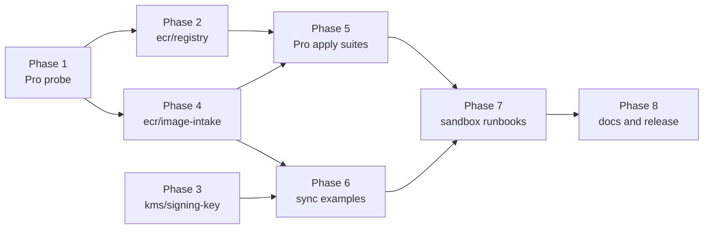

<!-- markdownlint-disable-file MD025 MD041 -->

# IMPL-0027: ECR registry, image intake and KMS signing key modules

**Status:** Draft
**Author:** Donald Gifford
**Date:** 2026-11-12

<!--toc:start-->
- [Objective](#objective)
- [Scope](#scope)
  - [In Scope](#in-scope)
  - [Out of Scope](#out-of-scope)
- [Test tiers](#test-tiers)
- [Implementation Phases](#implementation-phases)
  - [Phase 1: LocalStack Pro probe](#phase-1-localstack-pro-probe)
  - [Phase 2: ecr/registry module and plan suite](#phase-2-ecrregistry-module-and-plan-suite)
  - [Phase 3: kms/signing-key module](#phase-3-kmssigning-key-module)
  - [Phase 4: ecr/image-intake module and plan suite](#phase-4-ecrimage-intake-module-and-plan-suite)
  - [Phase 5: LocalStack Pro apply suites](#phase-5-localstack-pro-apply-suites)
  - [Phase 6: Sync examples](#phase-6-sync-examples)
  - [Phase 7: Sandbox runbooks](#phase-7-sandbox-runbooks)
  - [Phase 8: Docs, closure and release](#phase-8-docs-closure-and-release)
- [File Changes](#file-changes)
- [Testing Plan](#testing-plan)
- [Dependencies](#dependencies)
- [Open Questions](#open-questions)
  - [1. How is the work released?](#1-how-is-the-work-released)
  - [2. How are the LocalStack Pro suites positioned?](#2-how-are-the-localstack-pro-suites-positioned)
  - [3. Should the V1 ordering finding change DESIGN-0030?](#3-should-the-v1-ordering-finding-change-design-0030)
  - [4. Does release wait for the real-AWS sandbox legs?](#4-does-release-wait-for-the-real-aws-sandbox-legs)
  - [5. How does the sandbox stand in for the intake workflow?](#5-how-does-the-sandbox-stand-in-for-the-intake-workflow)
  - [6. Are the example tools pinned in mise.toml?](#6-are-the-example-tools-pinned-in-misetoml)
  - [7. Where does the internal-name check live?](#7-where-does-the-internal-name-check-live)
  - [8. Does kms/signing-key also get a Pro suite?](#8-does-kmssigning-key-also-get-a-pro-suite)
- [References](#references)
<!--toc:end-->

## Objective

Build the three modules specified by DESIGN-0030 and DESIGN-0031, all
OQs resolved 2026-11-12:

- **`modules/ecr/registry`**: the single owner of an ECR registry's
  registry-level configuration. It grants an account allow-list pull
  access to listed prefixes, explicitly denies those accounts the
  protected prefixes (`ConsumerDenyProtected`, DESIGN-0030 OQ 5b),
  pins `REGISTRY_POLICY_SCOPE = V2`, and manages scanning only when
  asked (off by default, OQ 7a).
- **`modules/kms/signing-key`**: an asymmetric `SIGN_VERIFY` key for
  cosign with an explicit admin/signer/verifier key policy and no root
  delegation.
- **`modules/ecr/image-intake`**: the `quarantine/` and promoted-prefix
  creation templates, the optional intake EventBridge rule, and the
  writer/intake policy JSON outputs, plus the sync examples
  (`crane` + `cosign`, `skopeo sync`, `helm`), shipped as docs only.

## Scope

### In Scope

- The three modules, each with a plan suite as the gate.
- A LocalStack **Pro** probe (Phase 1, **done**). It found Pro serves
  too little of either ECR module to apply it, so neither ships a
  `tests-localstack-pro/` suite unless OQ 2 decides otherwise.
- A Community apply suite for `kms/signing-key` (token-free 4.4 serves
  KMS signing, probed for DESIGN-0031).
- `tests-sandbox/` real-AWS runbooks for both ECR modules (DESIGN-0030
  OQ 11a, DESIGN-0031 testing strategy).
- The sync examples (`examples/` + README sections).
- ADR-0020's reserved `ecr/registry` flat key (DESIGN-0030 OQ 10a).
- READMEs, USAGE.md, the repo README module table, and CLAUDE.md.

### Out of Scope

- Any change to `ecr/org-registry` or `ecr/pull-through-cache`.
- The sync pipeline, the intake workflow and admission policies
  (outside this repo).
- The GitHub OIDC writer role. A web-identity trust channel for
  `iam/role` is a follow-up design (DESIGN-0031 OQ 9a).
- Replication configuration (a later additive input on `ecr/registry`).
- Remote-state keys for `ecr/image-intake` and `kms/signing-key`
  (DESIGN-0031 OQ 13a).

## Test tiers

| Module | Plan (`tests/`) | Community 4.4 | Pro (local only) | Real AWS (`tests-sandbox/`) |
| --- | --- | --- | --- | --- |
| `ecr/registry` | **Gate** | None (ECR not served) | None: pull grants rejected, scope setting unimplemented (Phase 1) | P1–P3, narrowing, protected deny, destroy |
| `ecr/image-intake` | **Gate** | None | None: creation templates unimplemented, no push events (Phase 1) | Isolation, services exemption, events, cosign, encryption, examples |
| `kms/signing-key` | **Gate** | Apply (wiring only) | Not needed (OQ 8) | Covered inside the image-intake cosign leg |

LocalStack does not evaluate ECR resource policies or KMS key policies
(INV-0012 F10; the DESIGN-0031 key-policy probe; Phase 1 confirmed a
deny-all repository policy is ignored on Pro). Every LocalStack apply
proves **wiring and config round-trip only**. Policy
semantics are proven at plan (shape) and in the sandbox (evaluation).



## Implementation Phases

Each task is checked off as it lands. Every phase ends with
`just static` green and a conventional commit.

### Phase 1: LocalStack Pro probe

Decides which ECR surfaces get a Pro apply suite. Token-free 4.4 serves
none of them (probed for DESIGN-0030), and `org-registry`'s FINDINGS
record `CreateRepositoryCreationTemplate` returning 501 on Pro
2026.6.0.

#### Tasks

- [x] Start LocalStack Pro locally and record the version:
      **`2026.10.7` (Pro, Enterprise license, `lstk` 1.4.5,
      `localstack-pro:latest`)**, probed 2026-11-12
- [x] Probe with the AWS CLI and `crane`, recording each result
      (table below)
- [x] Record the results in this IMPL (copied into each module's
      README "LocalStack" section in Phase 8)
- [x] Set the Phase 5 scope: **no Pro apply suite for either ECR
      module** (pending OQ 2)

**Probe results (LocalStack Pro 2026.10.7):**

| API / behaviour | Result |
| --- | --- |
| `PutRegistryPolicy` with V1-scope actions (`ReplicateImage`, `CreateRepository`, `BatchImportUpstreamImage`) | Accepted, read back by `GetRegistryPolicy`, deleted by `DeleteRegistryPolicy` |
| `PutRegistryPolicy` with pull actions (`BatchGetImage`) or a `Deny ecr:*` | **Rejected**: `InvalidParameterException: Invalid registry policy provided`. Pro models the **V1** policy scope only. |
| `PutAccountSetting` / `GetAccountSetting` | **Not implemented** (`InternalFailure`) |
| `PutRegistryScanningConfiguration` / `Get…` | Served, round-trips |
| `CreateRepositoryCreationTemplate` (any mutability) | **Not implemented**, unchanged since 2026.6.0 |
| `CreateRepository`, `SetRepositoryPolicy`, `PutImageTagMutability` (`IMMUTABLE_WITH_EXCLUSION` + filter) | Served |
| `crane copy` to a Pro ECR repository | Works (`--insecure`, `<acct>.dkr.ecr.<region>.localhost.localstack.cloud:4566`) |
| ECR `PUSH` → EventBridge rule → SQS | **No event delivered**, for either prefix |
| Deny-all repository policy, then `BatchGetImage` / `crane digest` | **Not enforced**: both succeed |
| Re-push of an identical tag + digest with `crane copy` to an `IMMUTABLE` repository | No-op: `crane` reports `existing manifest` and skips the write, so the ECR-side behaviour was not exercised |

**What this means:**

- `ecr/registry` can't apply on Pro at all: its pull grant and
  `ConsumerDenyProtected` are rejected, and the account setting
  doesn't exist. Only the off-by-default scanning resource is served.
- `ecr/image-intake` can't apply either: its creation templates are
  always created and are unimplemented, and push events never fire.
- **Design consequence, found here:** Pro's V1-only validation mirrors
  what a real **V1-scoped** registry is expected to do: reject a pull
  grant at `PutRegistryPolicy`. So the account setting must be applied
  **before** the policy. Phase 2 adds an explicit `depends_on`, and
  sandbox P1 checks the real V1 rejection.
- `crane copy` is idempotent by itself (it skips an existing manifest),
  which answers half of DESIGN-0031's re-push question. The sandbox
  still checks ECR's own behaviour with a raw re-push.

#### Success Criteria

- Every probe above has a recorded result against a named Pro version.
  **Met.**
- Phase 5's scope is written down per module. **Met: no Pro suites**,
  subject to OQ 2.

### Phase 2: ecr/registry module and plan suite

#### Tasks

- [x] Scaffold `modules/ecr/registry` (`versions.tf` with
      `required_version >= 1.9` and `aws ~> 6.2`; `.tflint.hcl`; no
      `tags` variable)
- [x] `data.aws_caller_identity` + `data.aws_region` (DESIGN-0030 OQ 9a)
- [x] Variables with every validation, one rule per block:
  - [x] `consumer_accounts` (12-digit keys; patterns name their own
        account; no whitespace; no equivalent-to-none pattern)
  - [x] `pull_repository_prefixes` and `protected_prefixes` (ECR name
        grammar; no duplicates)
  - [x] Cross-variable: accounts require prefixes; no pull/protected
        overlap in either direction
  - [x] `additional_policy_statements` (alphanumeric, unique sids;
        reserved `Consumer` prefix; effect enum; `ecr:` actions)
  - [x] `manage_registry_policy_scope` (default `true`)
  - [x] `scanning` (default `null`; type/frequency coherence; non-empty
        filters)
- [x] Locals composing `ConsumerPull`, `ConsumerPull<id>` and
      `ConsumerDenyProtected` with `jsonencode`, sorted inputs
- [x] `aws_ecr_registry_policy` (count on "any statement renders"),
      with the self-account precondition
- [x] `aws_ecr_account_setting` (count on the toggle, value `V2`)
- [x] `depends_on = [aws_ecr_account_setting.registry_policy_scope]` on
      the registry policy, so a V1 registry is switched to V2 before the
      pull grant is written (Phase 1 finding). A comment at the resource
      records why
- [x] `aws_ecr_registry_scanning_configuration` (count on
      `scanning != null`)
- [x] All eight outputs, including `consumer_identity_policy_json`
- [x] Plan suite (`mock_provider`), decoding the policy statement by
      statement:
  - [x] Bare call (no policy, scope `V2`, no scanning resource)
  - [x] One plain account; two plain accounts; one narrowed account;
        mixed
  - [x] `ConsumerDenyProtected` names every account and is absent with
        no accounts or no protected prefixes
  - [x] The deny survives an over-broad pass-through statement
  - [x] Reordered inputs render identical JSON
  - [x] Additive merge order; scanning on; output values
  - [x] Every rejection, verified per rule by message probe or mutation
  - [x] A positive run for every regex-shaped rule
- [x] `just tf docs ecr/registry` (lock-free form) and `just static`
- [x] `just changed` shows `ecr/registry` in the plan tier

**Build notes:**

- Extra validations beyond the design, each one rule: no duplicate
  patterns within an account, and `principals[].type` limited to
  `AWS` / `Service` (an unknown type would render a principal key IAM
  rejects at apply).
- `sort()` returns a typed **list**, which never equals a tuple
  literal in a `terraform test` assertion (`== ["a"]` is false; use
  `tolist([...])` or `length(...) == 0`). Two runs failed on this
  before the module was wrong about anything.
- Cross-run comparison (`run.<name>.registry_policy_json`) is how the
  ordering and deny-survival runs prove byte-identical rendering.

**Message-probe transcript (2026-11-13).** Each rejection run in
isolation, `expect_failures` removed, the real error read. Every run
fired exactly **one** error, at its own rule:

| Run | Rule that fired |
| --- | --- |
| `account_id_malformed` | `variables.tf:18` 12-digit keys |
| `pattern_names_another_account` | `variables.tf:25` own-account prefix |
| `pattern_with_whitespace` | `variables.tf:34` whitespace |
| `pattern_equivalent_to_no_narrowing` | `variables.tf:46` `:*` pattern |
| `duplicate_patterns` | `variables.tf:55` duplicates |
| `accounts_without_prefixes` | `variables.tf:65` cross-variable |
| `prefix_with_wildcard`, `prefix_uppercase`, `prefix_leading_slash` | `variables.tf:85` ECR grammar |
| `prefix_duplicate` | `variables.tf:90` duplicates |
| `prefix_equals_protected`, `prefix_inside_protected`, `prefix_contains_protected` | `variables.tf:97` overlap (cross-variable) |
| `protected_bad_grammar` | `variables.tf:115` ECR grammar |
| `protected_duplicate` | `variables.tf:120` duplicates |
| `sid_not_alphanumeric` | `variables.tf:157` sid grammar |
| `sid_duplicate` | `variables.tf:162` unique sids |
| `sid_reserved_prefix` | `variables.tf:167` reserved `Consumer` |
| `effect_not_enum` | `variables.tf:172` effect |
| `action_not_ecr` | `variables.tf:177` `ecr:` actions |
| `principal_type_not_allowed` | `variables.tf:182` principal type |
| `scan_type_unknown` | `variables.tf:216` scan type |
| `basic_with_continuous_scan`, `enhanced_with_manual` | `variables.tf:223` frequency coherence |
| `scan_rule_without_filters` | `variables.tf:233` non-empty filters |
| `self_account_rejected` | registry-policy precondition |

Positive runs (`grammar_edge_values_accepted`, `basic_manual_accepted`,
`enhanced_on_push_accepted`, plus every shape run) let valid values
through each regex and enum rule.

#### Success Criteria

- The plan suite is green, and each rejection run is recorded as
  firing its own rule (message or mutation). **Met: 45/45 runs; 26
  rejections message-probed, one rule each.**
- A bare call plans no registry policy and no scanning resource.
  **Met (`bare_call_renders_no_policy`).**
- `just static` is green. **Met; `just changed` shows plan tier
  only.**

### Phase 3: kms/signing-key module

#### Tasks

- [ ] Scaffold `modules/kms/signing-key` (`aws ~> 6.2`; `.tflint.hcl`;
      no `tags` variable)
- [ ] `aws_kms_key` (`SIGN_VERIFY`, `key_spec` default
      `ECC_NIST_P256`, `RSA_4096` allowed, `enable_key_rotation =
      false` pinned, 30-day window, `prevent_destroy`) and
      `aws_kms_alias`
- [ ] Key policy with `KeyAdministration` (`NotAction: kms:Sign`),
      `AllowSign` and an optional `AllowVerify`; no root delegation
- [ ] Principal validations (the five `iam/role` rules on each list;
      signers and admins disjoint)
- [ ] Precondition: the applying role (STS `assumed-role` ARN
      normalized to `<account>/<role-name>`) is in the admin list
- [ ] `data.aws_kms_public_key` and outputs, including
      `cosign_key_ref = awskms:///<key_arn>` and `signer_policy_json`
- [ ] Plan suite: bare call pins; key policy decoded; outputs;
      rejections verified per rule; positive regex runs
- [ ] Community apply suite (`tests-localstack/`, token-free 4.4,
      `SERVICES=kms,sts`): key and alias created, `public_key_pem` is a
      PEM block, spec and usage read back
- [ ] `FINDINGS.md` leading with the two 4.4 gaps (key policy not
      enforced; rotation accepted on an asymmetric key)
- [ ] `just tf docs kms/signing-key` and `just static`

#### Success Criteria

- Plan suite green, with `enable_key_rotation = false` and the
  no-root-delegation shape asserted.
- The Community apply passes live on 4.4, and `FINDINGS.md` records the
  run.
- `just changed` shows `kms/signing-key` in the plan and community
  tiers.

### Phase 4: ecr/image-intake module and plan suite

#### Tasks

- [ ] Scaffold `modules/ecr/image-intake` (`required_version >= 1.9`;
      `.tflint.hcl`; no `tags` variable)
- [ ] Template role (`custom_role_arn`, ECR-assumed) with
      `CreateRepository`, `PutLifecyclePolicy`, `SetRepositoryPolicy`,
      `TagResource` on the module's prefixes, plus KMS use when
      `kms_key_arn` is set
- [ ] Quarantine template: `MUTABLE`; expire-all lifecycle after
      `quarantine_retention_days`; `DenyNonPipelineImageAccess` with
      `ArnNotLike` + `BoolIfExists aws:PrincipalIsAWSService`
- [ ] Promoted templates (`for_each`): `IMMUTABLE_WITH_EXCLUSION` with
      `sha256-*`; no lifecycle; `DenyNonIntakeWrites` and
      `DenyNonAdminPolicyChanges`
- [ ] Encryption: AES256 default, `kms_key_arn` optional (DESIGN-0031
      OQ 8a)
- [ ] `resource_tags` from `data.aws_default_tags` (DESIGN-0029 pattern)
- [ ] Validations: the five ARN rules on all three lists; writer/intake
      disjoint; same-account writers (precondition); prefix grammar and
      overlap in every direction; retention range; exclusion filters;
      target `role_arn` requirement
- [ ] Optional event rule + target; `intake_event_pattern_json` always
      exported
- [ ] Outputs, including `promoted_prefixes` shaped for
      `ecr/registry`'s `pull_repository_prefixes`
- [ ] Plan suite: bare call; quarantine template (lifecycle and policy
      decoded); promoted templates (two-prefix run); policy outputs
      decoded and scoped; event pattern exact; rejections verified per
      rule; positive regex runs
- [ ] Confirm the ECR limit on exclusion filters per template and set
      the validation to it (DESIGN-0031 noted "five, to be confirmed")
- [ ] `just tf docs ecr/image-intake` and `just static`

#### Success Criteria

- Plan suite green, with writer and intake policy outputs proven to
  grant nothing outside their prefixes.
- Every rejection is recorded as firing its own rule.
- `just static` is green.

### Phase 5: LocalStack Pro apply suites

Phase 1 found nothing worth applying on Pro for either ECR module, so
this phase only records that decision (OQ 2a). If OQ 2 is answered
otherwise, the tasks below expand into a scanning-only
`ecr/registry` suite.

#### Tasks

- [ ] Each ECR module's README carries a "LocalStack" section with the
      Phase 1 table, naming what is not served and why there is no
      apply tier
- [ ] `just changed` shows both ECR modules in the plan tier only

#### Success Criteria

- No `tests-localstack-pro/` directory exists for the ECR modules, and
  the reason is documented where an engineer would look for the suite.

### Phase 6: Sync examples

#### Tasks

- [ ] `modules/ecr/image-intake/examples/manifest.example.yaml`
- [ ] `examples/github-actions-sync.yaml` (OIDC via
      `aws-actions/configure-aws-credentials`, actions pinned by SHA,
      Secrets Manager for upstream credentials, the `crane` + `cosign`
      loop, on merge plus nightly)
- [ ] `examples/skopeo-sync.example.yaml`
- [ ] README sections:
  - [ ] The `crane` + `cosign` writer flow (digest drift check, upstream
        verify, idempotent copy, `cosign copy`)
  - [ ] Intake promotion (`crane copy`, `cosign sign`, `cosign attest`
        with `awskms:///` and the transparency-log flag for the pinned
        cosign version)
  - [ ] `skopeo sync` as the batch alternative, with its limits
  - [ ] Chart conversion (`helm pull` → `helm push oci://`)
- [ ] Placeholder-only naming check (OQ 7)

#### Success Criteria

- Every example uses placeholder names only and states the tool
  versions it was written against.
- The README explains each step and when to choose `skopeo sync`.
- The examples are smoke-run in Phase 7.

### Phase 7: Sandbox runbooks

Real AWS, two accounts (registry and consumer), operator-run.

#### Tasks

- [ ] `modules/ecr/registry/tests-sandbox/` runbook (two AWS CLI
      profiles) covering:
  - [ ] P1: pull with no repository policy succeeds on `V2`. On `V1`,
        record whether `PutRegistryPolicy` itself rejects the pull grant
        (as Pro does) or accepts it and the pull fails
  - [ ] P1 ordering: from a V1 registry, one `terraform apply` switches
        to V2 and writes the policy without error (the `depends_on`)
  - [ ] P2: consumer refused on `quarantine/*`, allowed on `mirror/*`,
        and still refused with an over-broad pass-through statement
  - [ ] P3: a node not built by this repo pulls by digest with no node
        configuration
  - [ ] Narrowing: matching role allowed, non-matching refused
  - [ ] Destroy: consumer refused afterwards; scanning and scope
        observed and recorded
- [ ] `modules/ecr/image-intake/tests-sandbox/` runbook covering:
  - [ ] Writer: quarantine push OK, mirror push denied
  - [ ] Intake: quarantine pull, mirror push (OQ 5)
  - [ ] Isolation: unrelated role denied on quarantine; consumer
        denied on quarantine, allowed on mirror
  - [ ] Services: scan-on-push findings appear in quarantine
  - [ ] Events: one event per quarantine push, none for mirror
  - [ ] cosign: `sign` then `attest` with the `sha256-*` exclusion, and
        again without it (OCI 1.1 referrers)
  - [ ] Re-push of an identical tag and digest to an immutable repo
  - [ ] Encryption: consumer pull with `kms_key_arn` set (INV-0012 P4)
  - [ ] The Phase 6 examples, end to end once
- [ ] Record results in each module's `tests-sandbox/FINDINGS.md`
- [ ] Settle DESIGN-0031's revisit items from the results: the
      long-term mutability default (cosign leg) and the KMS README
      guidance (encryption leg)

#### Success Criteria

- Every leg has a recorded result.
- Any result that contradicts a design assumption is written back to
  the DESIGN (as a build note) and fixed in code or docs.

### Phase 8: Docs, closure and release

#### Tasks

- [ ] READMEs for all three modules:
  - [ ] `ecr/registry`: consumer contract, destroy and adoption,
        protected-prefix deny, ENHANCED-scanning cost note, LocalStack
        divergence
  - [ ] `ecr/image-intake`: layout, pairing with `ecr/registry`,
        policy outputs into `iam/role` / `eks/pod-identity-access`,
        examples
  - [ ] `kms/signing-key`: signing classes, cross-account verify, alias
        caveat, rotation stance
  - [ ] Cross-links between all three
- [ ] ADR-0020: reserved flat key `<account_name>/<region>/ecr/registry/`
- [ ] Repo README module table (`just readme`) and the coverage matrix
      check (`just readme --check`)
- [ ] CLAUDE.md: the new modules, the probe findings, and the
      follow-ups
- [ ] Mark DESIGN-0030 and DESIGN-0031 Implemented, this IMPL
      Completed; `docz update`, reverting unrelated ToC churn
- [ ] Release per OQ 1, with `### RELEASE NOTES` in each PR body

#### Success Criteria

- `just static`, `just docs lint` and `just readme --check` are green.
- All three modules are released, and the docs status matches.
- Open follow-ups (the `iam/role` web-identity channel, replication on
  `ecr/registry`, any sandbox-driven changes) are recorded.

## File Changes

```text
modules/ecr/registry/                 CREATE  module, tests/, tests-sandbox/, README.md, USAGE.md
modules/kms/signing-key/              CREATE  module, tests/, tests-localstack/, README.md, USAGE.md
modules/ecr/image-intake/             CREATE  module, tests/, tests-sandbox/, examples/,
                                              README.md, USAGE.md
docs/adr/0020-*.md                    EDIT    reserved ecr/registry key
docs/design/0030-*.md, 0031-*.md      EDIT    status; build notes if any
README.md                             EDIT    module table
CLAUDE.md                             EDIT    fleet notes
```

## Testing Plan

- **Plan suites** gate every module, run by `just tf test` and the CI
  plan tier.
- **Rejection discipline:** every `expect_failures` run is verified per
  rule by a message probe or mutation, and every regex rule has a
  positive run (IMPL-0020, IMPL-0024).
- **Community 4.4** applies `kms/signing-key` only.
- **Pro:** nothing. Phase 1 showed neither ECR module can apply there.
- **Sandbox** proves policy evaluation in real AWS.
- `just static` at every phase boundary.

## Dependencies

- DESIGN-0030 and DESIGN-0031 (resolved).
- A local LocalStack Pro container, for Phase 1 (done, `2026.10.7`).
- Two AWS sandbox accounts and an operator, for Phase 7.
- `crane`, `cosign`, `skopeo` and `helm` on the operator's machine for
  Phases 6–7.

## Open Questions

> **All resolved 2026-11-12: 1a through 8a.**
>
> - **OQ 2 (a):** no LocalStack Pro suites for any module in this IMPL.
>   Plan suites gate, `kms/signing-key` keeps its Community 4.4 apply,
>   and the sandbox proves policy evaluation.
> - **OQ 3 (a):** DESIGN-0030 carries a build note for the
>   account-setting → registry-policy ordering.

Each question lists **a** as the recommendation, then alternatives.
"Other" is open for your own answer.

### 1. How is the work released?

- **a. (Recommended) One PR per module, in order: `ecr/registry`, then
  `kms/signing-key`, then `ecr/image-intake` (with the examples).**
  Each is a minor release with its own release notes, and each is
  reviewable on its own. Phase 7's sandbox legs that need two modules
  run once `ecr/image-intake` lands.
- b. One PR and one release for all three.
- c. Two PRs, one per DESIGN.
- Other: ___

### 2. How are the LocalStack Pro suites positioned?

Phase 1 changed this question. Pro rejects the pull grant, lacks the
account setting and creation templates, and emits no push events.

- **a. (Recommended) No Pro suites for either ECR module.** Record the
  probe table in each README. Plan suites gate, and the sandbox proves
  evaluation.
- b. A scanning-only `ecr/registry` Pro suite (the one served
  resource). It needs a test-only switch to skip the policy and the
  account setting, which changes the module for the emulator.
- c. Re-probe on each new Pro release and add suites when templates
  ship.
- Other: ___

### 3. Should the V1 ordering finding change DESIGN-0030?

Pro rejects pull grants under its V1 model, and real V1 registries are
expected to as well.

- **a. (Recommended) Yes: add a build note to DESIGN-0030** recording
  the `depends_on` from the policy to the account setting, and that
  `manage_registry_policy_scope = false` is only safe on a registry
  already on V2 (the README says so).
- b. Also reject `manage_registry_policy_scope = false` combined with a
  non-empty `consumer_accounts`. Stricter, but it blocks registries
  whose scope is managed elsewhere.
- c. No design change; leave it to the IMPL and README.
- Other: ___

### 4. Does release wait for the real-AWS sandbox legs?

- **a. (Recommended) No.** Release on plan + LocalStack green. The
  runbooks ship with the modules, the operator runs them, and this IMPL
  stays open until they're recorded (the `s3/mirror-bucket` precedent).
- b. Yes. Nothing releases until Phase 7 is complete.
- c. Only `ecr/registry` waits (P1–P3 decide whether its grant works at
  all).
- Other: ___

### 5. How does the sandbox stand in for the intake workflow?

- **a. (Recommended) A plain IAM role named as the intake principal,
  driven by the AWS CLI, `crane` and `cosign` from the runbook.** It
  proves the AWS side without the real workflow.
- b. Wait for the real intake workflow to exist.
- c. A small Lambda that performs the promotion.
- Other: ___

### 6. Are the example tools pinned in mise.toml?

- **a. (Recommended) No.** The examples state the versions they were
  written against, and the sandbox FINDINGS record the versions used.
  This repo does not run them.
- b. Pin `crane`, `cosign` and `skopeo` in `mise.toml` with Renovate
  annotations.
- Other: ___

### 7. Where does the internal-name check live?

- **a. (Recommended) A local grep run at Phase 6 and Phase 8, using a
  list kept outside the repo.** Committing the list would itself leak
  the names.
- b. A CI check with the names stored as a repository secret.
- c. Review only.
- Other: ___

### 8. Does kms/signing-key also get a Pro suite?

- **a. (Recommended) No.** Community 4.4 serves everything the module
  creates, and Pro is not expected to enforce key policies either (it
  did not enforce ECR policies in Phase 1), so Pro adds no evidence.
- b. Yes, for parity with the ECR modules.
- Other: ___

## References

- DESIGN-0030: ECR registry module with a cross-account pull allow-list.
- DESIGN-0031: ECR image intake and KMS signing key modules.
- INV-0012: ECR cross-account sharing without org scope, and an image
  sync pipeline.
- IMPL-0025: `s3/mirror-bucket` (sandbox runbook; release before the
  live sandbox run).
- IMPL-0020, IMPL-0024: per-rule `expect_failures` verification;
  positive runs for regex rules.
- ADR-0019 / IMPL-0016: CI tiers and the `CI_RUN_LOCALSTACK_APPLY`
  toggle.
- ADR-0020: remote-state key contract.
