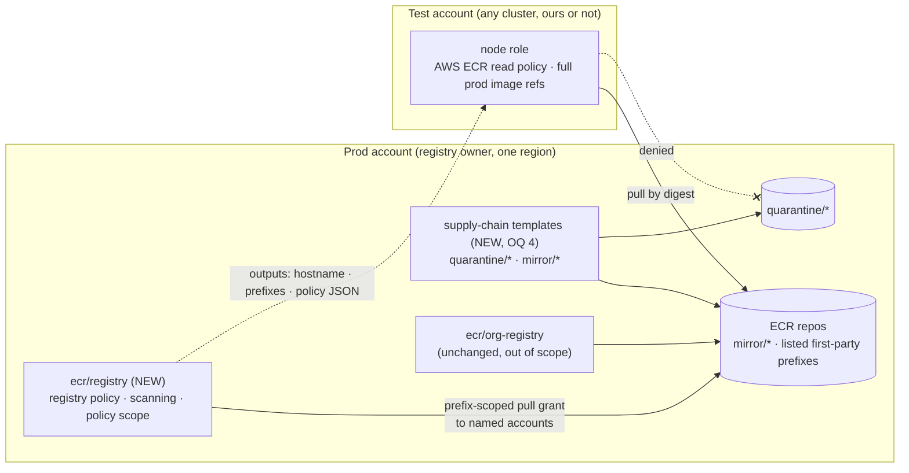
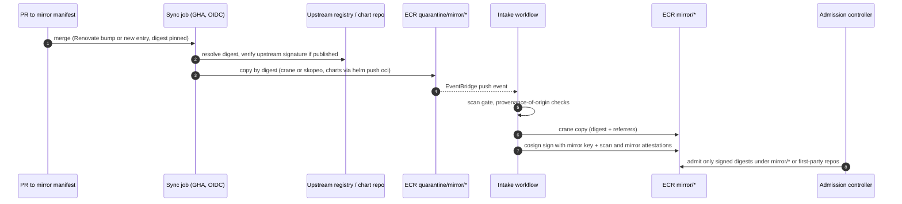

<!-- markdownlint-disable-file MD025 MD041 -->

# INV-0012: ECR cross-account sharing without org scope, and an image sync pipeline

<!--toc:start-->
- [Question](#question)
- [Hypothesis](#hypothesis)
- [Context](#context)
  - [Scope decision: no pull-through cache](#scope-decision-no-pull-through-cache)
- [Approach](#approach)
- [Environment](#environment)
- [Findings](#findings)
  - [F1 — No ECR module can share with a named account today (and none will be changed)](#f1--no-ecr-module-can-share-with-a-named-account-today-and-none-will-be-changed)
  - [F2 — Cross-account pull needs grants in both accounts](#f2--cross-account-pull-needs-grants-in-both-accounts)
  - [F3 — Registry-level settings are singletons](#f3--registry-level-settings-are-singletons)
  - [F4 — Creation-template policies only reach new repositories](#f4--creation-template-policies-only-reach-new-repositories)
  - [F5 — Account principals replace the org condition](#f5--account-principals-replace-the-org-condition)
  - [F6 — A registry-wide grant would expose quarantine](#f6--a-registry-wide-grant-would-expose-quarantine)
  - [F7 — Consumers come in two kinds](#f7--consumers-come-in-two-kinds)
  - [F8 — Sync runner and copy tool](#f8--sync-runner-and-copy-tool)
  - [F9 — Mirrored images need a trust story of their own](#f9--mirrored-images-need-a-trust-story-of-their-own)
  - [F10 — What belongs in this repo](#f10--what-belongs-in-this-repo)
- [Conclusion](#conclusion)
- [Recommendation](#recommendation)
  - [Proposed shape](#proposed-shape)
  - [Verification plan](#verification-plan)
- [Open Questions](#open-questions)
  - [1. Who owns registry-level configuration?](#1-who-owns-registry-level-configuration)
  - [2. How are consumer accounts named?](#2-how-are-consumer-accounts-named)
  - [3. How is the cross-account grant scoped?](#3-how-is-the-cross-account-grant-scoped)
  - [4. Where do the quarantine and mirror templates live?](#4-where-do-the-quarantine-and-mirror-templates-live)
  - [5. Does the consumer side need a module?](#5-does-the-consumer-side-need-a-module)
  - [6. What happens to ecr/pull-through-cache?](#6-what-happens-to-ecrpull-through-cache)
  - [7. What runs the sync?](#7-what-runs-the-sync)
  - [8. Which copy tool does the sync use?](#8-which-copy-tool-does-the-sync-use)
  - [9. Where do upstream credentials for the sync live?](#9-where-do-upstream-credentials-for-the-sync-live)
  - [10. How are mirrored third-party images trusted?](#10-how-are-mirrored-third-party-images-trusted)
  - [11. How is cross-account access verified?](#11-how-is-cross-account-access-verified)
  - [12. How does this fan out into DESIGN docs?](#12-how-does-this-fan-out-into-design-docs)
- [References](#references)
<!--toc:end-->

## Question

Two linked questions.

1. **Cross-account registry.** A prod account and a test account sit in
   a larger AWS org, in the same region. Can our ECR modules give the
   prod account a registry that the test account can also pull from,
   **without** an org-wide or OU-wide grant? The module should take an
   explicit **account allow-list**. What does a new `ecr/registry`
   module need to own, and what stays out of it?
2. **Image sync pipeline.** What automation (Lambda, GitHub CI job, or
   other) should sync commonly used containers, Helm charts and pinned
   versions from their upstreams into that registry? It has to fit the
   internal supply-chain standards: only our registry (or approved
   registries) admitted at the cluster, plus signing, scanning,
   quarantine and revocation.

## Hypothesis

- Cross-account sharing is mostly **additive policy surface**:
  registry and repository policies naming accounts instead of
  `aws:PrincipalOrgID`. The registry-level policy is a singleton, so it
  needs one owner, which no current module can be.
- A Lambda is the wrong runner for image sync. Images can be large,
  and the supply-chain pipeline already has an intake workflow. The sync job's
  only responsibility should be getting approved upstream artifacts
  into `quarantine/`. The existing intake gate does the rest.

## Context

**Triggered by:** a request to run ECR in one account and region,
shared with named sibling accounts, plus an internal supply-chain
programme. Two internal standards (drafts, not linked here) set the
expectations:

- *A container image standard*: one registry, deny by default, every
  image signed by a CI identity, digest-pinned references.
- *A signed-and-scanned pipeline*: "push ≠ available". Writers push
  only to `quarantine/`. An intake workflow (EventBridge → a workflow
  engine) verifies, scans, copies to the real repository and attests.
  Admission controllers (for example Kyverno, or a commercial
  scanner's admission webhook) admit only our signatures from our
  registry.

The standards assume a shared-services registry pulled **org-wide**
(`aws:PrincipalOrgID`). This investigation covers the
narrower deployment the request describes: the registry sits in a
workload account (prod), and access is granted per named account.

**Consumer clusters are not assumed to be ours.** The EKS clusters in
prod and test may be built with none of this repo's modules: no
`eks/*` remote state, no `eks/managed-node-group`, and node roles whose
names and policies we neither choose nor see. The registry side must
work from **account IDs and a published contract alone**. Clusters
built with our modules should still have an easy path (F7).

Today's modules (`v0.27.0`), both **untouched by this work**:

- `ecr/org-registry` (DESIGN-0006 / IMPL-0006): create-on-push
  templates for `helm-charts/*` and `tf-modules/*` OCI artifacts, an
  org-wide pull policy, and a KMS key. **Out of scope (2026-11-12):**
  this work adds nothing to it. The new module must coexist with it in
  the same registry without changing its behaviour (F3).
- `ecr/pull-through-cache` (DESIGN-0005 / IMPL-0005): PTC rules,
  upstream credentials, a `ROOT` creation template. Out of scope
  (below).

### Scope decision: no pull-through cache

An earlier draft of this investigation extended the pull-through cache
cross-account. That was **dropped (2026-11-12)**. Once the sync
pipeline exists, the cache duplicates it for every image that matters,
and with weaker guarantees:

| | Pull-through cache | Sync pipeline |
| --- | --- | --- |
| What gets in | Anything a node asks for | Only what the approved manifest lists |
| When it is usable | Immediately, no quarantine | After intake passes |
| Signed by us | Never (fails the signing rule) | Yes |
| Revocable | Only by deleting the image | Yes, recorded and enforced at admission |
| Helm charts from HTTPS repos | No (OCI upstreams only) | Yes (`helm pull` → `helm push oci://`) |

Under the standards' end state, a cached image cannot be admitted
except in namespaces exempted from signature checks. The
sync pipeline is the only ingress for clusters that enforce
admission. The existing module is left as it is (OQ 6).

## Approach

1. Read `ecr/org-registry` and `ecr/pull-through-cache` end to end for
   every place access is decided, to know what the new module must
   coexist with.
2. Read the AWS docs on registry permissions and cross-account pulls,
   and quote the load-bearing sentences.
3. Map each standards control (registry, intake, admission) onto what
   a module would have to own.
4. Compare sync runners and copy tools against the pipeline invariants
   (quarantine first, digest-preserving copy, referrers travel).
5. Defer anything that needs real policy evaluation to a sandbox probe
   (OQ 11). LocalStack stores ECR policies but does not evaluate them,
   the same finding as the `s3/mirror-bucket` probe.

## Environment

| Component | Version / Value |
| --- | --- |
| Modules | `ecr/org-registry`, `ecr/pull-through-cache` at `v0.27.0` |
| Terraform / provider | 1.15.8 / `hashicorp/aws` 6.72.0 (`~> 6.2`) |
| References | Internal container image standard and signed-and-scanned pipeline (drafts, not linked) |
| AWS docs read | ECR registry permissions; repository policies; PTC IAM (2026-11-12) |

## Findings

### F1 — No ECR module can share with a named account today (and none will be changed)

| Module | Access surface | Cross-account today |
| --- | --- | --- |
| `org-registry` | Both templates embed `org_pull`: `Principal "*"` + `aws:PrincipalOrgID = var.organizations_org_id` (required, validated). | Org-wide only (out of scope; unchanged). |
| `pull-through-cache` | `ROOT` creation template with no `repository_policy`; node policy scoped to its own account. | None (out of scope). |

No module manages `aws_ecr_registry_policy`, account settings,
scanning configuration or replication. A repo-wide grep finds none of
those resources anywhere in `modules/`. So the account allow-list has
no existing home, and a **new `ecr/registry` module** is the answer
by construction, not by preference.

### F2 — Cross-account pull needs grants in both accounts

The registry permissions page: "Amazon ECR allows all ECR actions in
the policy and enforces the registry policy in all ECR requests." So
the **registry policy** can grant the pull actions
(`BatchGetImage`, `GetDownloadUrlForLayer`,
`BatchCheckLayerAvailability`) across many repositories at once,
including ones not yet created. Older registries can still be on the
V1 policy scope, which covered only replication and PTC actions.
Whether ours need `aws_ecr_account_setting`
`REGISTRY_POLICY_SCOPE = V2` is **probe P1**.

Cross-account access is always two-sided:

| Side | Grant | Actions |
| --- | --- | --- |
| Prod (resource) | Registry policy, and/or repository policy | `BatchGetImage`, `GetDownloadUrlForLayer`, `BatchCheckLayerAvailability` |
| Test (identity) | Node role IAM, **owned by whoever built the cluster** | `ecr:GetAuthorizationToken` (`*`) + the same pull actions on prod's repository ARNs |

EKS node roles normally carry an AWS-managed ECR policy
(`AmazonEC2ContainerRegistryReadOnly`, or `…PullOnly` on newer setups
such as Auto Mode) with the pull actions on `Resource "*"`. That
already satisfies the test side. It is conventional, **not
guaranteed**: a cluster we don't build may use a hand-scoped node
policy. Dropping the pull-through cache removed the only case that
needed new consumer-side grants (cache population).

### F3 — Registry-level settings are singletons

`aws_ecr_registry_policy` is one document per account and region, and
`PutRegistryPolicy` replaces it. Two modules that each manage one in
the same registry overwrite each other on every apply, with a
permanent diff and no error. The same holds for
`aws_ecr_registry_scanning_configuration` and
`aws_ecr_replication_configuration`.

Purpose modules (`org-registry` today, the supply-chain templates in
OQ 4 tomorrow) can run side by side in one registry, so none of them
can safely own a registry singleton. `ecr/registry` is that owner.
This is the same shape as the `s3/bucket` /
`aws_s3_bucket_notification` lesson: one owner, or a silent
last-writer-wins.

**Coexistence with `org-registry`.** Its repository policies
(`org_pull`) are stamped per repository and are untouched. ECR
evaluates the registry policy and the repository policy together, so
the new grant only **adds** access: an allow-listed account gains
read on whichever prefixes the caller lists, and nothing
`org-registry` grants is removed. If a caller wants allow-listed
accounts to read `helm-charts/*` too, they list that prefix in
`ecr/registry`. No `org-registry` change is involved.

### F4 — Creation-template policies only reach new repositories

A creation template's `repository_policy` is stamped onto a repository
**when ECR creates it**. Existing repositories keep whatever policy
they had, and changing the template later never backfills. That is
visible in `org-registry`'s `org_pull` today: editing it would change
only repositories pushed afterwards.

So the **registry policy** is the primary grant channel for
cross-account pulls. It covers existing and future repositories, and
it changes in place. A template `repository_policy` is a second,
per-prefix layer. It is the right home for **write** restrictions
(only intake writes to `mirror/*`), but a poor home for read grants
that may change.

### F5 — Account principals replace the org condition

Without an org condition, the grant names accounts:
`Principal = { AWS = ["arn:aws:iam::<test>:root", ...] }`. The `:root`
principal means "this account's IAM decides": any principal the test
account grants ECR read to can pull. It does not mean "the root
user". Two optional narrowings:

- `aws:PrincipalArn` with `ArnLike` on role-name patterns, which
  limits pulls to node roles even if the test account is generous.
  This needs the consumer's role naming, which we only know for
  clusters we build, so it is an **opt-in per account**.
- `aws:SourceVpce` for VPC-endpoint-only pulls (the `s3/mirror-bucket`
  pattern), if the consumer's endpoint IDs are known.

Account-ID principals carry none of IMPL-0022's dangling-principal
risk: an account ARN cannot be "created later" the way a mistyped role
name can. They still need the fleet's standard validation (exactly 12
digits, no duplicates, not the registry's own account). A typo in an
account ID grants to a stranger's account, so the list should be
validated and plan-pinned like `iam/role`'s `trusted_role_arns`.

### F6 — A registry-wide grant would expose quarantine

The pipeline layout puts unvetted artifacts in `quarantine/*` in the
**same** registry, readable only by intake and the writer. A registry
policy granting the test account `repository/*` would let it pull
quarantined images. Admission should still reject them unsigned, but
the "push ≠ available" invariant would then rest on admission alone.

Two shapes avoid that:

- **Prefix allow-list:** the `Allow` names only consumable prefixes
  (`repository/mirror/*` and whichever first-party prefixes the caller
  lists). Anything new is unreadable cross-account until listed.
- **Allow all, deny quarantine:** `Allow` on `repository/*` plus an
  explicit `Deny` on `repository/quarantine/*` for everyone except the
  intake and writer roles.

The allow-list fails closed. A new prefix is invisible until someone
adds it, rather than readable until someone remembers to deny it.
Which shape is chosen is OQ 3, and P2 proves it in the sandbox.

### F7 — Consumers come in two kinds

| | **Contract path** (cluster not built by us) | **Easy path** (our `eks/*` modules) |
| --- | --- | --- |
| Who is granted | The account, as `arn:aws:iam::<id>:root` (F5) | Same, optionally narrowed to our node-role naming |
| Pull permissions | The ECR read policy the node role normally already has (F2) | Same |
| Image addressing | Full prod hostname, digest-pinned | Same |
| What we publish | Registry hostname, consumable prefixes, and a minimal identity-policy JSON as outputs, plus a README contract | The same outputs |

**Design rule:** the producer never reads consumer state or assumes our
modules on the other side. Its only consumer inputs are account IDs,
plus optional ARN patterns.

**Image addressing.** Consumers reference images as
`<prod>.dkr.ecr.<region>.amazonaws.com/mirror/docker-hub/library/nginx@sha256:…`.
The image standard already requires digest pins, and the
admission allow-list needs an explicit registry anyway. The kubelet
ECR credential provider on EKS AMIs matches any
`*.dkr.ecr.*.amazonaws.com` host, and an ECR auth token works for any
registry the principal is allowed into. So this should need no node
configuration at all. That is **probe P3**; it is expected, not yet
observed.

**Aside, outside this investigation's scope.** `eks/managed-node-group`
has a containerd mirror feature that redirects upstream hosts to
pull-through-cache prefixes. Two of its mechanics are unverified:

- the kubelet credential provider is keyed on the image's own registry
  (`docker.io`), so it may never hand an ECR token to the mirror host;
- a path-prefixed mirror host (`https://<host>/docker-hub`) may need
  `override_path` in `hosts.toml`.

If either holds, that is a latent defect in the existing module,
worth its own issue regardless of what happens here.

### F8 — Sync runner and copy tool

| Runner | Fit | Problems |
| --- | --- | --- |
| **GitHub Actions** (on merge to a manifest repo, plus a nightly drift run) | OIDC to a push role, no stored AWS keys. PR review **is** the approval gate. Renovate bumps versions as PRs. Logs and history for free. | Hosted-runner disk (~14 GB free) limits very large images. Mitigated by streaming copy tools, which never unpack layers. |
| **Lambda** (EventBridge Scheduler) | No runner to manage. | 15-minute timeout and 10 GB ephemeral storage. A copy tool binary to package. A second pipeline to maintain. No natural approval point. |
| **The intake's workflow engine** | Already runs intake, with retries and idempotent IDs. | Approval still needs a source of truth (a manifest in git). Couples sync changes to the platform team's release cadence. |
| **CodeBuild / Step Functions** | AWS-native, large disks. | More IaC and a second CI surface, with no advantage over GHA here. |

The deciding property is **where approval lives**. A declarative
manifest in git (image, upstream, tag, **pinned digest**; chart, repo,
version), edited by PR and bumped by Renovate, gives review, history
and revocation in one place. Any runner can execute it. GHA is the one
simplest to wire with OIDC → ECR push.

Copy tools (resolved by OQ 8: documented examples, no bespoke tool):

- **`crane` + `cosign` (primary example).** `crane digest` resolves a
  tag to a digest; `crane copy <upstream>@<digest> <ecr>/quarantine/…`
  streams every platform by digest. `cosign verify` checks the
  upstream signature where the publisher provides one, and
  `cosign copy` carries upstream signatures and attestations
  alongside the image.
- **`skopeo sync` (alternative).** One YAML of repositories and tags,
  synced in a batch. Good for bulk catch-up, but it handles images
  only and does not carry cosign signatures, so verification has to
  run separately.

All of these stream layers registry to registry. For charts,
`helm pull` + `helm push oci://…` converts HTTPS chart repos into OCI
artifacts.

**Delivery is documentation, not a product.** These ship as worked
examples in the OQ 4 module's README (or an `examples/` directory):
a sample manifest, a sample GitHub Actions workflow wired to the push
role over OIDC, and the `crane` / `cosign` / `skopeo` command
sequences. The repo builds no sync tool and runs no pipeline.

The sync job now talks to upstreams directly, so it needs upstream
credentials (Docker Hub auth, mainly for rate limits). That is OQ 9.

### F9 — Mirrored images need a trust story of their own

A synced upstream image has none of our CI signatures, provenance or
OCI labels. Three options:

1. **Intake vouches.** Intake first verifies the **upstream**
   signature where the publisher provides one (`registry.k8s.io`,
   Chainguard and most CNCF projects sign with cosign), then runs the
   scan gate. It then signs the promoted digest with a **distinct
   mirror key** and attaches `example.com/scan/v1` plus an `example.com/mirror/v1`
   predicate (upstream ref, digest, upstream-signature result).
   Admission trusts mirror-key signatures for `mirror/*` only.
2. **Reuse the intake key.** Simpler, but it blurs "we built it" and
   "we vetted someone else's build" in every audit query.
3. **Don't sign.** Third-party images can then only run in
   namespaces exempted from signature checks, and the signing rule
   stays unmet.

Revocation works through the existing mechanisms:

- A manifest entry gains `revoked: true`.
- The sync job writes an `example.com/revocation/v1` attestation, and
  admission denies the digest (a Kyverno deny list or the scanner's
  generated from the manifest).
- The rescan workflow's `result: fail` already blocks promotion and
  trips the freshness gate.

Nothing is deleted by automation, matching the pipeline's "nothing is
ever deleted by the workflow" rule.

### F10 — What belongs in this repo

Per the fleet rule that Terraform manages AWS APIs only (no Kubernetes
objects):

| Concern | Home |
| --- | --- |
| Registry policy, scanning config, `REGISTRY_POLICY_SCOPE`, later replication | **This repo**: a registry-singleton module (F3) |
| `quarantine/` and `mirror/` creation templates (immutable, lifecycle, write-restricted policies) | **This repo**: OQ 4 |
| Sync push role (OIDC trust, push to `quarantine/*` only) | **This repo**: `iam/role` already fits |
| KMS signing keys (`SIGN_VERIFY`, per-class key policies) | **This repo**: a new small module (nothing in the fleet mints asymmetric keys today) |
| EventBridge rule for a `quarantine/` push → intake | **This repo**, small, or with the intake infrastructure |
| Manifest, sync workflow, intake activities | **Outside**: a manifest repo plus the platform team's repo |
| Admission policies (Kyverno or similar) | **Outside**: GitOps (e.g. Argo CD), never Terraform |

Verification: LocalStack 4.4 stores ECR registry and repository
policies but does not evaluate them (the same class of finding as
`s3/mirror-bucket`'s star-principal probe). Cross-account pull and
deny behaviour can only be proven in a **two-account sandbox**.

## Conclusion

**Answer:** Yes. ECR can serve named sibling accounts without an org or
OU grant, using no new resource types. The grant belongs in the
**registry policy** (F2, F4), a per-registry singleton (F3) that no
current module owns, so it lives in a **new `ecr/registry` module**
with an account allow-list. The grant must be **scoped by prefix** so
it never reaches `quarantine/*` (F6). Neither existing ECR module is
changed. The pieces:

- a **new singleton module**, `ecr/registry`: account allow-list,
  prefix-scoped registry policy, scanning, policy scope;
- the **quarantine and mirror repository templates** for the
  supply-chain flow (OQ 4);
- a **published consumer contract** (hostname, prefixes, policy JSON),
  which works for clusters we don't build. For pull-only, no consumer
  module is needed (F7, OQ 5).

Out of scope: `ecr/org-registry` (unchanged, coexists) and the
pull-through cache (the sync pipeline replaces it for every image
that matters).

The sync is a **push-driven pipeline**: a git manifest, a GHA job into
`quarantine/`, and the existing intake gate. It is not a Lambda.
This repo contributes its AWS infrastructure (templates, roles, keys,
event rule). The workflow code and admission policies live elsewhere.

## Recommendation

### Proposed shape

Suggested next steps:

1. Resolve the OQs below.
2. Run the sandbox probes P1–P4 before writing the design (OQ 11).
3. Write the DESIGN(s) per OQ 12.
4. Raise the pipeline itself (manifest repo, sync workflow, intake
   activities) in the platform team's repo, citing the standards.

### Verification plan

| Probe | Question | Tier |
| --- | --- | --- |
| P1 | Does a registry policy carrying pull actions grant a cross-account pull on a repository with **no** repository policy, and is `REGISTRY_POLICY_SCOPE = V2` required for that? | Two-account sandbox |
| P2 | With the OQ 3 shape applied, is the test account refused on `quarantine/*` and allowed on `mirror/*`? | Sandbox |
| P3 | On a node we did **not** build, does a full prod-hostname, digest-pinned reference pull cross-account with no node configuration? | Sandbox |
| P4 | Does a KMS-encrypted `mirror/*` repository serve cross-account pulls with a default key policy (service-side decrypt), or does the key policy need the consumer accounts? Decides whether the OQ 4 module must thread the allow-list into its key policy. | Sandbox |
| P5 | Shape: does the plan render the registry policy as expected for one and for two accounts (the single-element collapse)? | Plan tier, offline |

## Open Questions

> **All resolved 2026-11-12: 1a, 2a, 3a, 4a, 5a, 6a, 9a, 10a, 11a,
> 12a; 7 and 8 resolved with modifications.**
>
> - **OQ 7 (a, as an example):** GitHub Actions is the reference
>   runner, but the repo ships it as a **sample workflow in the
>   module docs**, not a supported pipeline. Teams adapt it.
> - **OQ 8 (modified):** no bespoke sync tool and no `regsync`. The
>   docs carry `crane` + `cosign` examples (resolve digest, verify
>   upstream signature, copy by digest, carry signatures), plus a
>   `skopeo sync` batch option, with notes on when to use each (F8).
> - **Naming:** examples use placeholder names only (`example.com/…`
>   predicate types, `alias/example-…` keys, generic prefixes). No
>   internal programme, platform or tool names appear in module code
>   or docs.

Each question lists **a** as the recommendation, then alternatives.
"Other" is open for your own answer.

### 1. Who owns registry-level configuration?

- **a. (Recommended) A new `ecr/registry` singleton module**, one per
  account and region. It owns `aws_ecr_registry_policy`, the
  `REGISTRY_POLICY_SCOPE` account setting, the scanning configuration
  and later replication, plus the account
  allow-list. Purpose modules never touch registry-level state (F3).
- b. A raw resource in the live repo. That avoids a module, but the
  grant shape is then untested and unvalidated.
- Other: ___

### 2. How are consumer accounts named?

- **a. (Recommended) A list of 12-digit account IDs, rendered as
  `arn:aws:iam::<id>:root` principals, with optional per-account
  `principal_arn_patterns` narrowing via `aws:PrincipalArn`.**
  Validation covers shape, duplicates and the registry's own account
  (F5). The single-element collapse is asserted for one and two
  accounts (P5).
- b. Exact principal ARNs only (node roles). Tighter, but every new
  node group in any consumer account becomes a prod-side change, and
  we often don't know those role names (F7).
- c. Accounts plus an optional org ID, both accepted in one list.
- Other: ___

### 3. How is the cross-account grant scoped?

- **a. (Recommended) A prefix allow-list.** The `Allow` names only
  consumable prefixes (`mirror/*` plus caller-listed first-party
  prefixes). It fails closed, and quarantine is unreachable without an
  explicit deny (F6).
- b. `repository/*` plus an explicit `Deny` on `quarantine/*`. Simpler
  to read, but any new prefix is exposed by default.
- c. `repository/*` with no deny, relying on admission to reject
  unsigned quarantine images.
- Other: ___

### 4. Where do the quarantine and mirror templates live?

- **a. (Recommended) A new purpose module, `ecr/supply-chain-registry`
  (name open).** It owns the `quarantine/` template (7-day lifecycle,
  read only by intake and writer) and the `mirror/` template
  (immutable, KMS, write only by intake). First-party prefixes
  can join later.
- b. Put them in `ecr/registry`. That mixes singleton settings with
  per-prefix templates.
- Other: ___

### 5. Does the consumer side need a module?

- **a. (Recommended) No module for now.** `ecr/registry` publishes the
  hostname, consumable prefixes and a minimal identity-policy JSON as
  outputs, and its README states the contract. Pull-only is already
  covered by the ECR read policy EKS node roles normally carry (F2).
  Add a consumer module only when a real consumer lacks that policy.
- b. A small `ecr/pull-access` module now, for clusters built with our
  modules (`extra_node_policies`).
- c. Document the JSON in the README only, with no outputs.
- Other: ___

### 6. What happens to ecr/pull-through-cache?

- **a. (Recommended) Leave the module as it is, with no new features.**
  Retire its deployments stack by stack once the sync manifest covers
  what each cluster runs. Mark it deprecated in its README when the
  last consumer is gone.
- b. Deprecate it now.
- c. Keep it as a non-prod convenience indefinitely.
- Other: ___

### 7. What runs the sync?

- **a. (Recommended) A GitHub Actions workflow** in a manifest repo,
  run on merge plus nightly. It uses OIDC to a push role limited to
  `quarantine/*`. The intake workflow remains the only writer of real
  repositories (F8).
- b. Lambda on EventBridge Scheduler. Its runtime and disk limits bite
  on large images, and it has no approval point.
- c. A schedule in the intake's workflow engine end to end. A good
  long-term home, but approval still needs the git manifest.
- d. CodeBuild.
- Other: ___

### 8. Which copy tool does the sync use?

- **a. (Recommended) `crane` + `cosign` as the documented example**,
  with `skopeo sync` as a documented batch alternative, and
  `helm pull` + `helm push oci://` for HTTPS chart repos (F8).
- b. A declarative sync tool (regclient's `regsync` or similar).
- c. A bespoke sync tool in this repo.
- Other: ___

### 9. Where do upstream credentials for the sync live?

- **a. (Recommended) Secrets Manager in the registry account, read by
  the sync role via OIDC**, using the fleet's `secretsmanager/secret`
  pattern. Rotation and audit then stay in AWS, next to the registry.
- b. GitHub Actions secrets on the manifest repo.
- c. Anonymous pulls only. Docker Hub rate limits make this fragile.
- Other: ___

### 10. How are mirrored third-party images trusted?

- **a. (Recommended) Intake vouches with a distinct mirror KMS key.**
  It runs after the upstream signature is verified (where published)
  and the scan gate passes. It attaches `example.com/scan/v1` and
  `example.com/mirror/v1`, and admission trusts that key for `mirror/*`
  only (F9).
- b. Reuse the intake key.
- c. Don't sign; run third-party images only in exempted namespaces.
- Other: ___

### 11. How is cross-account access verified?

- **a. (Recommended) Plan-tier suites plus a `tests-sandbox/` runbook**
  in two real accounts. The plan tier asserts policy shape. The
  runbook runs P1–P4 before the design is approved, following
  `s3/mirror-bucket`'s pattern. LocalStack cannot evaluate the
  policies (F10).
- b. Plan tier only, and trust the AWS docs.
- Other: ___

### 12. How does this fan out into DESIGN docs?

- **a. (Recommended) Two DESIGNs**: (1) the cross-account registry,
  covering `ecr/registry` and the consumer contract; (2) supply-chain registry infrastructure, covering the
  quarantine/mirror templates, the sync push role, signing keys and
  the intake event rule. The pipeline code is a platform-repo design
  that cites both.
- b. One combined DESIGN.
- c. DESIGN (1) now; defer (2) until the internal standards leave
  draft.
- Other: ___

## References

- Internal container image standard and signed-and-scanned pipeline
  standard (drafts; deliberately not named or linked here).
- DESIGN-0005 / IMPL-0005: `ecr/pull-through-cache` (out of scope
  here; OQ 6).
- DESIGN-0006 / IMPL-0006: `ecr/org-registry` (org-wide pull policy;
  out of scope, coexists).
- DESIGN-0028 / IMPL-0025: `s3/mirror-bucket` (VPCE-scoped access,
  `tests-sandbox/` runbook pattern, LocalStack non-evaluation finding).
- DESIGN-0025 / IMPL-0022: `iam/role` (account-ID validation, the
  dangling-principal lesson).
- AWS: *Private registry permissions in Amazon ECR*; *Amazon ECR
  repository policies*; *IAM permissions required to sync an upstream
  registry with an Amazon ECR private registry* (read 2026-11-12).
